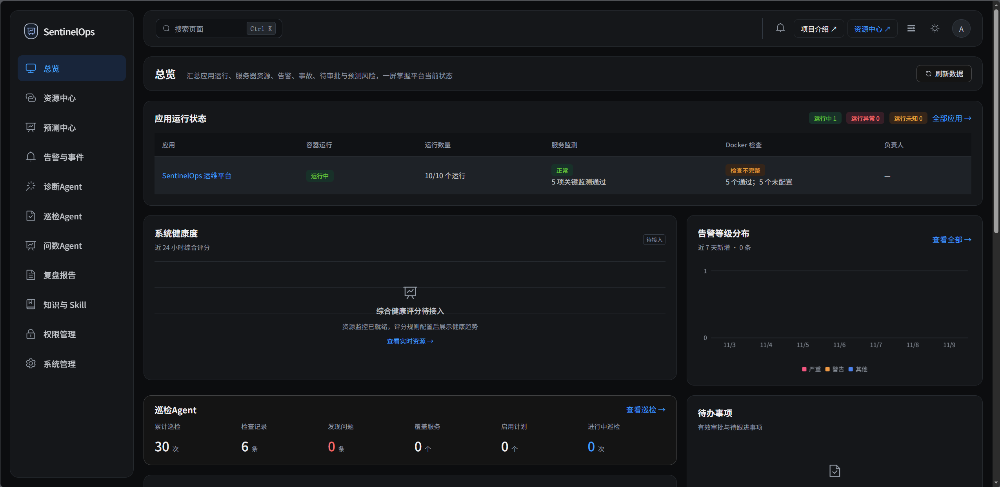
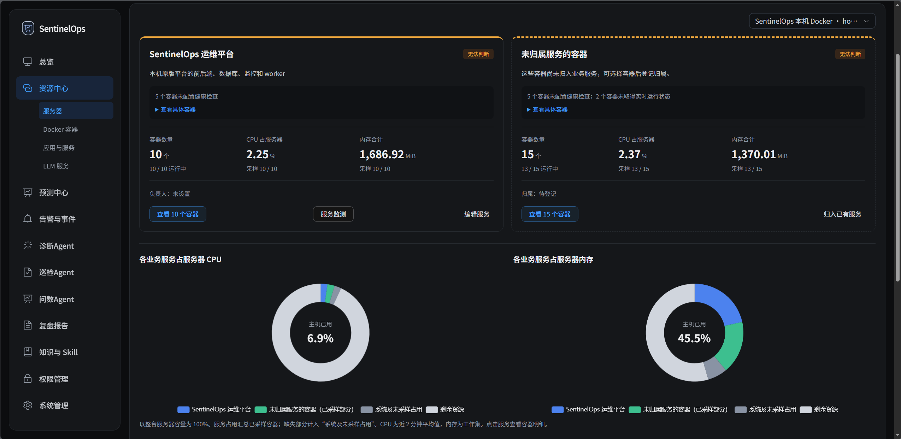
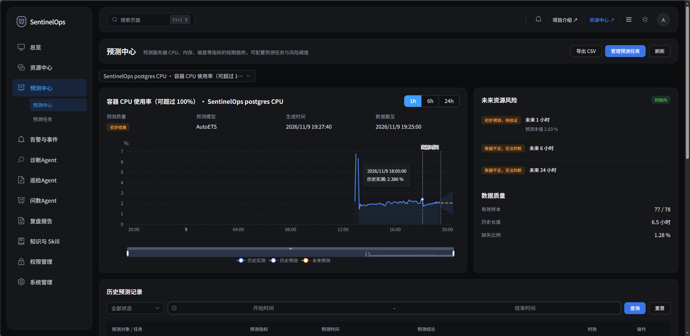
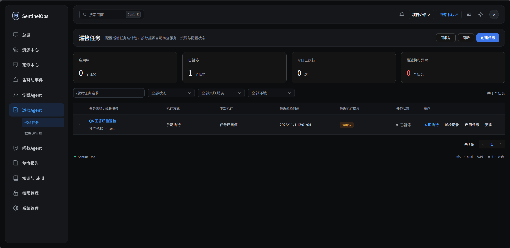
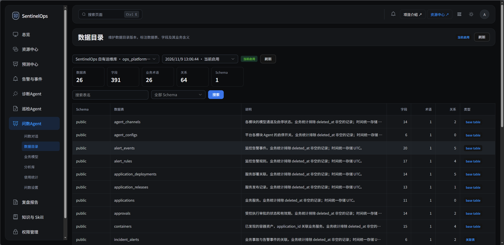
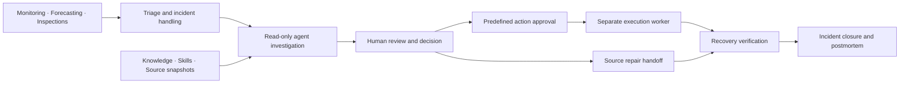
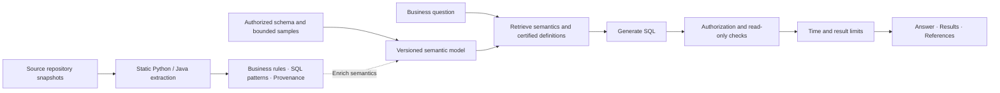

<div align="center">
  
  <h1>SentinelOps</h1>
  <p><strong>Agent-assisted predictive operations for Docker applications</strong></p>
  <p>Connect runtime signals, business data, and source evidence across investigation, controlled response, and review.</p>
  <p><a href="README.md">简体中文</a> · English</p>
</div>

[Core Features](#core-features) · [Screenshots](#screenshots) · [Agent Features](#agent-features) · [How it works](#how-it-works) · [Installation](#installation) · [Quickstart](#quickstart) · [Software Components](#software-components)

SentinelOps is a **self-hosted, human-in-the-loop operations platform** for Docker-based applications and AI services. It brings resource monitoring, forecasting, business inspections, incident diagnosis, approved execution, and postmortems into a shared workspace, with a web console and a Windows desktop client.

The platform addresses three questions: **Is the system healthy, how should an anomaly be investigated, and how can the outcome be verified and retained?** Diagnosis agents combine runtime evidence with deployed source context; inspection agents follow business Skills; query agents combine database semantics with code rules. People decide which conclusions to adopt and which changes to execute.



## Core Features

- **A shared resource and service view.** Manage applications, services, hosts, Docker containers, critical APIs, databases, and LLM services with metrics, availability checks, and dependency context.
- **Forecast-driven risk detection.** Combine threshold alerts, seasonal forecasting, and anomaly detection. Inspect 1 / 6 / 24-hour trends, prediction intervals, estimated threshold crossings, and data quality.
- **Skill-driven business inspections.** Connect APIs, databases, and other sources. Apply rules and agents to individual business objects, retaining results, evidence, execution trajectories, and human reviews.
- **Source-aware incident diagnosis.** Organize alerts, metrics, container state, knowledge, and deployment-bound source snapshots into an investigation context, with continued conversation, evidence review, and repair handoffs.
- **Database and code-aware querying.** Extend schema and business definitions with candidate rules and SQL patterns extracted from Python / Java source. Preserve provenance to enrich semantic models and natural-language queries.
- **Approval, verification, and review.** People approve predefined actions; a separate worker executes them and checks recovery. Frozen incident records produce report drafts for review before export or delivery.

### What makes SentinelOps different?

| Design focus | How it appears in the product |
| --- | --- |
| Runtime evidence tied to code versions | Applications, releases, deployments, and source snapshots connect evidence to the relevant version and file location |
| Database schema + code business rules | Source repository integration and rule extraction extend Auto-Ontology with business meaning and provenance |
| Repeatable business procedures | Versioned Skills describe workflows and criteria that guide authorized evidence collection and computation |
| Visible agent activity | Model requests, tool calls, evidence, execution steps, and human adoption are persisted and streamed through SSE |
| Human decisions and controlled execution | Diagnosis is read-only by default; approvals bind a target, action version, and parameters, with separate execution and recovery records |

## Screenshots

### Resources and services

Inspect containers by business service, including CPU and memory usage, unassigned resources, and missing health-check configuration.



### Forecasting

View historical observations, forecasts, quality, and freshness together, including explicit insufficient-history states.



### Inspection Agent

Organize inspections around tasks, schedules, runs, and object results, with manual execution, pausing, and review.



### Query Agent

Manage a versioned catalog of tables, fields, business terms, and relationships as context for natural-language querying.



These five screenshots were supplied by the project maintainer and retain the page states at capture time. See [screenshot notes](docs/images/readme/README.md).

## Agent Features

### Diagnosis Agent

Investigates an incident using alerts, metrics, container state, knowledge, and source evidence. Supports personal conversations, additional input during a run, and explicit adoption of conclusions.

**Implementation:** DeepSeek Harness runs in an isolated subprocess, collecting evidence through a restricted MCP tool gateway. Versioned diagnosis Skills guide the investigation. Structured candidates undergo evidence-reference and permission checks before adoption. The default mode is read-only and does not propose actions. [Workspace guide](docs/frontend/AI诊断工作台.md) · [Harness adapter](backend/app/integrations/harness.py).

### Inspection Agent

Checks business objects against a Skill, querying authorized sources, searching prior results, and using Python for comparisons and computation. Produces per-object pass, fail, or unknown results.

**Implementation:** Supports both collect-then-check and Agent Skill inspection modes. Harness orchestrates authorized tools; a separate broker runs Python in temporary containers. Plan, Skill, and source versions are bound to the run snapshot. Tool evidence is persisted before reaching the model, and the backend validates conclusions and citations. [Inspection center](docs/backend/巡检中心.md) · [Agent Skill inspections](docs/backend/Agent-Skill自主巡检.md).

### Query Agent

Answers questions using schema, business terms, metric definitions, and business rules from code, returning inspectable SQL, tables, charts, and references.

**Implementation:** Extends NVIDIA Auto-Ontology's semantic compilation, retrieval, and Text-to-SQL capabilities with platform integration. Git / SVN / local source snapshots provide static Python / Java rule extraction and SQL patterns. Authorized candidate rules enrich semantic models. Queries pass table/column authorization, read-only SQL validation, time limits, and result limits. [Implementation guide](docs/backend/智能问数实施进度.md) · [Code rules](backend/app/services/askdata_code_rules.py) · [Query orchestration](backend/app/services/askdata_query.py).

### Postmortem Agent

Drafts reports from closed incidents, organizing impact, causes and evidence, response, lessons, improvements, and unresolved evidence gaps.

**Implementation:** Harness reads frozen evidence through a dedicated tool and returns a fixed report structure. The platform validates references and preserves revisions. People edit and review drafts before PDF / Word export; an administrator explicitly initiates email delivery. [Report structure](docs/backend/复盘报告大纲.md) · [Generation workflow](backend/app/workers/reports.py).

### Evaluation Replay

Compares diagnosis configurations or Skills against historical cases to inform later improvements.

**Implementation:** Versioned cases preserve frozen tool results, baselines, and human labels. Harness replays against frozen tools, and deterministic checks assess outputs. Replay does not execute actions on live targets. [Evaluation implementation](backend/app/services/operations/evaluation.py).

### Shared runtime

- **Task-bound authorization:** tools are scoped to the task; calls recheck users, resource access, and configuration versions.
- **Persisted execution:** states, tool results, evidence, and visible responses support live views, cancellation, and interruption records.
- **Separate model channels:** diagnosis, inspection, postmortem, and evaluation configure primary and ordered fallback channels. Querying selects existing diagnosis channels for reasoning and lightweight calls.
- **Usage and cost visibility:** track provider-reported tokens, latency, failures, and fallback attempts, with costs estimated from configured prices.

Inspection Python executes in temporary containers without network access or host-directory mounts, with resource and time limits. An unavailable sandbox fails explicitly. Time-series algorithms handle forecasting; an approval-aware worker handles actions. See [model channel configuration](docs/backend/Agent模型配置.md).

## How it works



1. **Observe and forecast:** exporters, API checks, and LLM probes provide signals. Prometheus stores time series; forecasting tasks assess trends and risk.
2. **Investigate with evidence:** the platform assembles incident context. Agents collect facts through authorized tools, preserving timestamps and sources for human review and adoption.
3. **Respond and verify:** operators request approved actions or hand source issues to developers. Execution, version registration, and recovery verification are recorded separately.
4. **Review and reuse:** frozen incident records produce report drafts for review. Authorized history search and case replay make prior work reusable.

### Database + code semantics



Source repositories add business meaning and provenance to database structure. Rules retain file locations and snapshot links, supporting revision, conflict handling, and human certification. Queries prioritize certified definitions. Source integration is optional, and target programs are never imported or executed. See [implementation and validation](docs/backend/智能问数实施进度.md) for static extraction coverage and quality boundaries.

## Software Components

| Component | Technology | Role |
| --- | --- | --- |
| Web console | Vue 3, TypeScript, Vite, Vue Router, Pinia, Element Plus, ECharts | Resource, incident, inspection, query, and administration workspace |
| Windows client | Electron, electron-builder / NSIS | Shared Vue UI connected to a separately deployed server |
| Backend API | Python 3.12, FastAPI, Pydantic, SQLAlchemy, Alembic | Workflows, permissions, transactions, OpenAPI, and SSE |
| Agent runtime | DeepSeek Harness SDK, MCP, model gateway | Skills, restricted tools, model channels, and usage records |
| Query semantic layer | NVIDIA Auto-Ontology, LangChain / LangGraph, SQLGlot | Semantic compilation, retrieval, Text-to-SQL, and SQL validation |
| Code semantics extension | Git / SVN snapshots, Python AST, static Java parsing | Candidate rules and SQL extraction, version and source provenance |
| Application and vector storage | PostgreSQL 17, pgvector | Assets, tasks, evidence, approvals, semantic models, and embeddings |
| Local knowledge retrieval | FastEmbed / ONNX, BGE Chinese embedding model | Chunking, embeddings, and retrieval |
| Metrics and alerts | Prometheus, Alertmanager, Blackbox exporter, node-exporter, cAdvisor | Collection, probes, alerts, and notifications |
| Forecasting | StatsForecast, MSTL, AutoETS | Seasonal decomposition, resource forecasts, and quality assessment |
| Execution and sandbox | Separate execution worker, containerized Python broker | Approved actions and isolated computation |
| Deployment and dependencies | Docker Compose, Nginx, uv, pnpm | Builds, locked dependencies, reverse proxy, and startup |

The backend is a modular monolith. The API and seven fixed background consumers share the Backend container as separate processes. PostgreSQL persists tasks; approved execution and inspection sandboxes run separately. See the [deployment layout](docs/backend/容器合并与部署.md).

## Installation

### Requirements

- Docker Engine / Docker Desktop with Compose v2 and Linux containers.
- uv and Python 3.12 for configuration setup. Initial builds and model downloads require network access.
- PowerShell for the Windows startup script; Linux can use the Compose sequence below.
- Node.js 22, at least 22.12, and pnpm `11.19.0` only for frontend development or desktop builds.

Download or clone this repository and run commands from its root. These are **first-install** steps. For an existing environment, follow the [upgrade and backup guide](docs/backend/容器合并与部署.md).

### 1. Initialize configuration

```sh
uv sync --project backend --frozen
uv run --project backend python backend/scripts/init_env.py
uv run --project backend python backend/scripts/init_monitoring.py
uv run --project backend python backend/scripts/prepare_ai.py
```

Setup creates `.env`, separate secrets, monitoring configuration, and a pinned local knowledge embedding model. `init_env.py` exits if `.env` already exists. Adjust ports as needed. To enable AI, set `AI_ENABLED=true` in `.env` before starting; configure model keys later in the administration UI.

### 2. Start the server

Windows / PowerShell:

```powershell
./deployment/Start.ps1
```

Linux / manual first install:

```sh
docker compose build backend frontend
docker compose up -d --wait postgres
docker compose run --rm --no-deps migrate
docker compose run --rm --no-deps prepare-volumes
docker compose --profile monitoring --profile execution up -d --wait
```

### 3. Create an administrator and install Skills

```sh
docker compose exec backend /app/.venv/bin/python -m app.cli.bootstrap --username admin
docker compose exec backend /app/.venv/bin/python -m scripts.seed_knowledge
```

Enter an administrator password of at least 12 characters at the prompt. The default web URL is **<http://127.0.0.1:8080>**, with API documentation at <http://127.0.0.1:8000/docs>. Use the configured ports if you changed `.env`.

Default ports bind to loopback. To connect from another computer, configure a reachable reverse proxy endpoint with HTTPS.

<details>
<summary>Optional: inspection Python sandbox, local collectors, and a test mailbox</summary>

Initialize the sandbox credential, then start the components you need:

```powershell
uv run --project backend python deployment/inspection-sandbox/prepare.py
./deployment/Start.ps1 -InspectionSandbox
```

Add `-LocalCollectors` for local collectors, `-MailTest` for Mailpit, or `-LocalSources` for a configured read-only source mount. The sandbox broker and some collectors require Docker socket access; enable them as needed. Deploying collectors to managed servers requires explicit authorization. See [sandbox details](docs/backend/Agent-Skill自主巡检.md).

</details>

### Windows desktop

Download the Windows x64 installer or standalone ZIP from [GitHub Releases](https://github.com/kongtou-1/SentinelOps/releases). The client targets Windows 10 / 11 x64 and requires a separately deployed server. Enter the server's **root URL**, such as `https://ops.example.com`, test the connection, and sign in. Do not append `/api/v1`.

See the [desktop guide](desktop/README.md) for builds, installer status, and known startup issues.

## Quickstart

| Goal | Start here | Result |
| --- | --- | --- |
| Understand application health | Register applications, servers, and services in the resource center; link containers, critical APIs, and databases | A shared view of applications, dependencies, and metrics |
| Enable agents | System administration → Agent configuration; configure and test model channels | Available models and separate usage records |
| Investigate an incident | Alerts and events → Incident details → AI diagnosis | Tool activity, evidence references, and a candidate conclusion for adoption |
| Build a business inspection | Configure data sources, Skills, checks, and a schedule under Inspection Agent | Per-object results, execution trajectories, evidence, and reviews |
| Ask a data question | Query Agent → Settings: register a read-only connection, authorize tables/columns, select channels, and build a model | An inspectable answer, SQL, result table, and references |
| Add code business rules | Connect application source snapshots, then extract and review rules during model compilation | Business semantics linked to source locations |
| Retain incident learning | Generate a postmortem after closure, then edit and review it | Exportable reports and improvement actions |

Start with one application, one observable API, and one read-only source, then add inspections and semantic models. Monitored LLM services and the platform's agent model channels are managed separately. The current product UI is primarily Chinese.

## Development

Install and start the frontend:

```sh
corepack pnpm@11.19.0 --dir frontend install --frozen-lockfile
corepack pnpm@11.19.0 --dir frontend dev
```

The frontend runs at `http://127.0.0.1:5173`, proxying API calls to local port `8000`. Start a development API with:

```sh
uv run --project backend uvicorn app.main:app --host 127.0.0.1 --port 8000 --reload
```

Prepare the database, configuration, and migrations first; stop a container API using the same port. See [frontend development](docs/frontend/启动与开发.md), [backend layout and migrations](docs/backend/项目组织与迁移.md), and [desktop builds](desktop/README.md). Detailed module documents are currently in Chinese.

Main checks:

```sh
corepack pnpm@11.19.0 --dir frontend test
corepack pnpm@11.19.0 --dir frontend build
corepack pnpm@11.19.0 --dir desktop test
```

Backend tests require an explicit, separate database whose name ends in `_test`, configured according to [conftest.py](backend/tests/conftest.py). Do not run tests against a business database.

## Documentation

| Topic | References |
| --- | --- |
| Deployment | [Container layout and startup](docs/backend/容器合并与部署.md), [project layout and migrations](docs/backend/项目组织与迁移.md) |
| API | [API reference](docs/backend/API接口汇总.md), [data structures](docs/backend/API数据结构.md), [OpenAPI](docs/backend/openapi.json) |
| Agents and diagnosis | [Model channels](docs/backend/Agent模型配置.md), [diagnosis workspace](docs/frontend/AI诊断工作台.md), [default diagnosis Skill](docs/backend/默认只读诊断Skill.md) |
| Inspections | [Inspection center](docs/backend/巡检中心.md), [Agent Skill inspections](docs/backend/Agent-Skill自主巡检.md) |
| Natural-language querying | [Implementation and validation](docs/backend/智能问数实施进度.md), [upstream adaptations](backend/vendor/auto-ontology/SENTINELOPS_PATCHES.md) |
| Permissions and postmortems | [Resource permissions](docs/backend/权限与资源授权.md), [report structure](docs/backend/复盘报告大纲.md) |

## Status

The repository provides web platform source and a Windows desktop project; published versions and assets depend on the actual Release. Forecasts require sufficient, fresh metrics, and agent conclusions need evidence review. Module documents describe validation coverage for code-rule extraction, query scale, and model quality. Automatic Skill extraction/publication and unattended remediation are future directions.

## Acknowledgements

Natural-language querying **adapts and extends [NVIDIA Auto-Ontology](https://github.com/NVIDIA/auto-ontology)**. SentinelOps draws on its semantic-layer design and reuses core semantic catalog, compilation, retrieval, and Text-to-SQL modules. The pinned upstream revision is [`c4495670947eb7b4616f0dd9900e5ced2a48ca1e`](https://github.com/NVIDIA/auto-ontology/tree/c4495670947eb7b4616f0dd9900e5ced2a48ca1e), vendored under [`backend/vendor/auto-ontology/`](backend/vendor/auto-ontology/).

SentinelOps adds **repository and deployment-snapshot integration, Python / Java business-rule and SQL extraction, source provenance, rule review, and certification**. These extensions connect to platform-specific table/column authorization, read-only SQL checks, versioned storage, model channels, execution records, and the Vue workspace, combining database semantics with code business context. See the [patch log](backend/vendor/auto-ontology/SENTINELOPS_PATCHES.md) and [source manifest](backend/vendor/auto-ontology/SENTINELOPS_UPSTREAM.json).

The default SRE diagnosis Skill is adapted from [Jeffallan/claude-skills: sre-engineer](https://github.com/Jeffallan/claude-skills/tree/958e60fb998e008507c978b7943211f337def6a6/skills/sre-engineer), translated and mapped to platform tools and a read-only scope. See the [adaptation notes](docs/backend/默认只读诊断Skill.md).

SentinelOps-owned code is licensed under [Apache-2.0](LICENSE). Auto-Ontology's [license](backend/vendor/auto-ontology/LICENSE) and [third-party notices](backend/vendor/auto-ontology/THIRD_PARTY_NOTICES.md), and the diagnosis Skill's [MIT license](backend/app/skills/sre-diagnosis/LICENSE), are retained.
