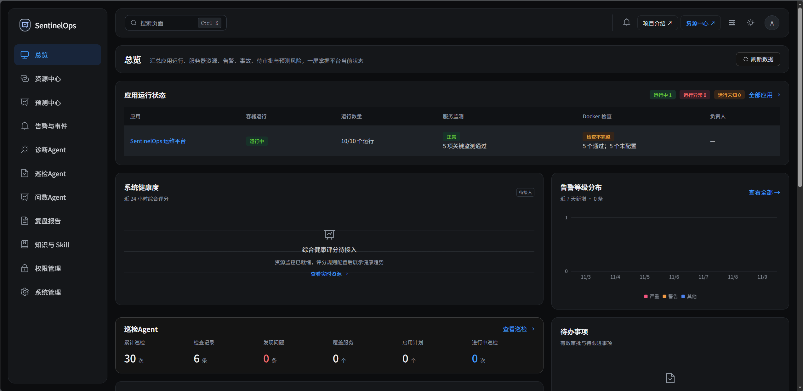
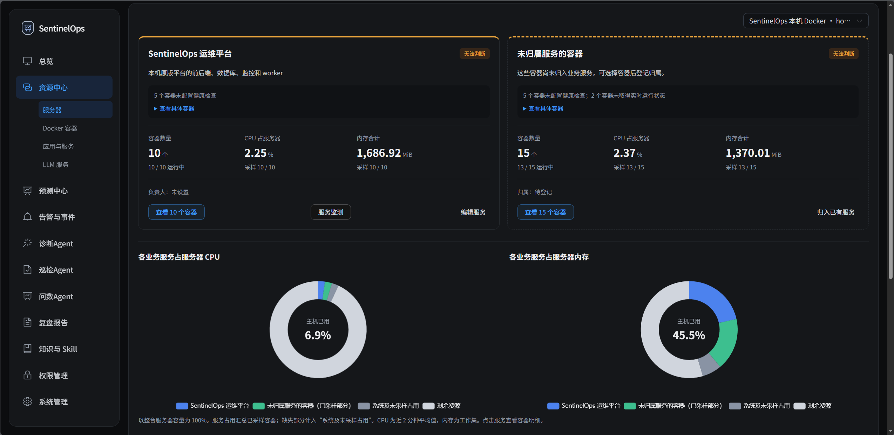
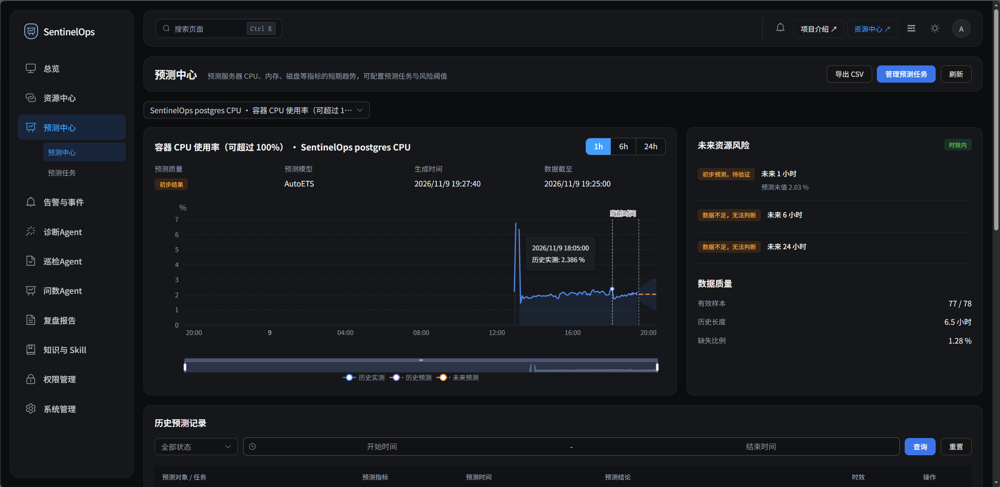
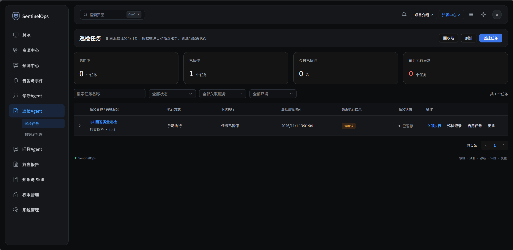
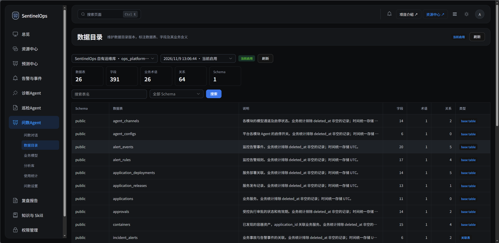
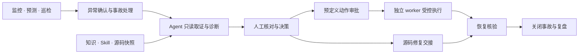
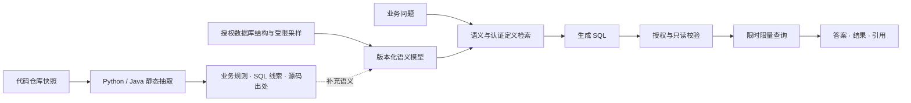

<div align="center">
  
  <h1>SentinelOps</h1>
  <p><strong>面向 Docker 应用的 Agent 辅助预测运维平台</strong></p>
  <p>连接运行信号、业务数据与源码证据，贯通发现、诊断、受控处置和复盘。</p>
  <p>简体中文 · <a href="README.en.md">English</a></p>
</div>

[核心能力](#core-features) · [界面预览](#screenshots) · [Agent 能力](#agent-features) · [工作原理](#how-it-works) · [安装](#installation) · [快速上手](#quickstart) · [技术组件](#software-components)

SentinelOps 是一个可自行部署的**人机协同智能运维平台**，面向运行在 Docker 中的业务应用与 AI 服务。它将资源监控、趋势预测、业务巡检、事故诊断、审批执行和复盘放在同一工作台中，提供 Web 控制台与 Windows 桌面客户端。

平台围绕三个问题组织能力：**系统现在是否健康，异常应该如何排查，处理结果如何验证与沉淀。** 诊断 Agent 联合运行证据与部署源码定位问题，巡检 Agent 按业务 Skill 检查对象，问数 Agent 结合数据库语义与代码规则解释业务数据；人工决定结论采用与变更执行。



## Core Features

- **统一资源与业务视图。** 管理应用、服务、主机、Docker 容器、关键 API、数据库与 LLM 服务，关联运行指标、接口可用性和服务依赖。
- **预测驱动的风险发现。** 结合阈值告警、周期预测和异常检测，查看 1 / 6 / 24 小时趋势、预测区间、预计超限时间与数据质量。
- **Skill 驱动的业务巡检。** 接入 API、数据库等数据源，用规则与 Agent 检查业务对象，保存逐项结果、证据、运行轨迹和人工复核记录。
- **关联源码的事故诊断。** 将告警、指标、容器状态、知识和部署源码快照组织为诊断上下文，支持持续对话、证据核对与修复交接。
- **数据库与代码库联合问数。** 在数据库结构与业务定义之外，引入 Python / Java 源码中的候选业务规则和 SQL 线索，保留出处，辅助语义建模与自然语言查询。
- **审批、验证与复盘闭环。** 预定义动作经过人工审批，由独立 worker 执行并核验恢复；事故资料冻结为报告草稿，经审核后导出或发送。

### What makes SentinelOps different?

| 设计重点 | 在平台中如何体现 |
| --- | --- |
| 运行事实与代码版本关联 | 将应用、发布、部署与源码快照关联，诊断证据可追溯到当时的版本和文件位置 |
| 数据库结构 + 代码业务规则 | 基于 Auto-Ontology 扩展代码仓库接入与规则抽取，为数据目录补充业务含义和来源 |
| 可复用的业务检查流程 | 版本化 Skill 描述业务流程和判断标准，Agent 据此组织授权取证与计算 |
| 看得见的 Agent 过程 | 保存模型请求、工具调用、证据、运行步骤与人工采用结果，通过 SSE 实时展示 |
| 人工决策与受控执行 | 诊断默认只读；审批绑定目标、动作版本和参数，执行结果与恢复核验分别记录 |

## Screenshots

### 资源与服务

按业务服务查看容器运行状态及 CPU、内存占用，识别尚未归属服务或缺少检查配置的资源。



### 趋势预测

将历史观测、未来预测、预测质量与数据新鲜度放在同一视图中，明确展示历史不足等状态。



### 巡检 Agent

通过任务、调度、执行记录和对象结果组织业务巡检，支持手动执行、暂停与复核。



### 问数 Agent

浏览版本化数据目录中的表、字段、业务术语与关系，为问数提供可管理的语义上下文。



以上五张图片由项目维护者提供，保留截取时的真实页面状态。[截图说明](docs/images/readme/README.md)。

## Agent Features

### Diagnosis Agent · 诊断 Agent

围绕一次事故读取告警、指标、容器状态、知识与源码证据，形成可供人工核对的原因分析。支持个人会话、运行中补充信息和手动采用结论。

**实现：** DeepSeek Harness 在隔离子进程中运行，通过受限 MCP 工具网关取证；加载版本化诊断 Skill，提交结构化候选，后端校验证据引用与权限。默认只读，不生成动作提案。[诊断工作台](docs/frontend/AI诊断工作台.md) · [Harness 适配](backend/app/integrations/harness.py)。

### Inspection Agent · 巡检 Agent

按业务 Skill 检查对象，可查询授权数据源、检索历史记录，并用 Python 完成比较与计算；逐项输出正常、异常或待确认结果。

**实现：** 支持“采集后逐条检查”和“Agent Skill 自主巡检”。Harness 组织授权工具调用，Python 经独立 broker 在临时容器中执行；计划、Skill 和数据源版本绑定本轮快照，工具证据持久化后再交给模型，结论与引用经过后端校验。[巡检中心](docs/backend/巡检中心.md) · [Agent Skill 巡检](docs/backend/Agent-Skill自主巡检.md)。

### Query Agent · 问数 Agent

结合数据库结构、业务术语、指标定义和代码中的业务规则回答问题，返回可核对的 SQL、表格、图表与引用。

**实现：** 在 NVIDIA Auto-Ontology 的语义编译、检索与 Text-to-SQL 能力上扩展平台集成；接入 Git / SVN / 本地源码快照，静态抽取 Python / Java 业务规则与 SQL 线索，将授权范围内的候选规则关联到语义模型。查询统一经过表列授权、只读 SQL 校验、超时和结果限制。[问数实现](docs/backend/智能问数实施进度.md) · [代码规则](backend/app/services/askdata_code_rules.py) · [查询编排](backend/app/services/askdata_query.py)。

### Postmortem Agent · 复盘 Agent

根据已关闭事故的记录生成报告草稿，整理影响、原因与证据、处置、经验和改进措施，保留事实缺口。

**实现：** Harness 通过专用工具读取冻结证据，按固定结构输出。平台校验引用、保存修订，人工编辑与审核后可导出 PDF / Word；邮件投递由管理员显式发起。[报告结构](docs/backend/复盘报告大纲.md) · [生成流程](backend/app/workers/reports.py)。

### Evaluation Replay · 评测回放

用历史案例比较诊断模型配置或 Skill 的变化，辅助改进后续诊断。

**实现：** 版本化案例保存冻结工具结果、基线与人工标签，Harness 在冻结工具集上回放，结合确定性检查评价输出。回放不对实时目标执行操作。[评测实现](backend/app/services/operations/evaluation.py)。

### Shared runtime

- **任务级授权：** 工具随任务绑定，调用时复核用户、资源权限与配置版本。
- **持久化过程：** 保存状态、工具结果、证据与公开回复，支持实时查看、取消与中断状态记录。
- **独立模型通道：** 诊断、巡检、复盘和评测分别配置主用与顺序备用通道；问数选择已有诊断通道作为推理 / 轻量通道。
- **用量与成本：** 记录供应商返回的 Token、耗时、失败及备用尝试，按配置价格估算费用。

巡检 Python 的临时执行容器无网络、无宿主目录挂载，并限制资源和运行时间；沙箱不可用时明确失败。预测由时序算法完成，动作执行由审批 worker 完成。[模型通道说明](docs/backend/Agent模型配置.md)。

## How it works



1. **感知与预测：** exporter、API 探测和 LLM Probe 提供运行信号，Prometheus 保存时序，预测任务评估趋势与风险。
2. **取证与诊断：** 平台组织事故上下文，Agent 在授权工具内读取事实；证据保留采样时间与来源，由人工核对并采用结论。
3. **处置与验证：** 运维人员申请预定义动作审批，或将源码问题交接给开发处理。执行、版本登记和恢复核验分别保存。
4. **复盘与复用：** 冻结事故资料形成报告草稿，人工审核；诊断与巡检历史可按权限检索，案例可用于评测回放。

### Database + code semantics



代码库为数据库结构补充业务含义与出处。规则保留文件位置与快照关联，支持修订、冲突处理和人工认证；查询优先采用认证口径。源码接入可选，目标程序不会被导入或执行；静态抽取覆盖范围和实际质量见[实现与验证记录](docs/backend/智能问数实施进度.md)。

## Software Components

| 组件 | 技术 | 职责 |
| --- | --- | --- |
| Web 控制台 | Vue 3、TypeScript、Vite、Vue Router、Pinia、Element Plus、ECharts | 资源、事故、巡检、问数与管理工作台 |
| Windows 客户端 | Electron、electron-builder / NSIS | 复用 Vue 页面，连接独立部署的后台 |
| 后端 API | Python 3.12、FastAPI、Pydantic、SQLAlchemy、Alembic | 业务流程、权限、事务、OpenAPI 与 SSE |
| Agent 运行时 | DeepSeek Harness SDK、MCP、模型网关 | Skill 加载、受限工具、模型通道与用量记录 |
| 问数语义层 | NVIDIA Auto-Ontology、LangChain / LangGraph、SQLGlot | 语义编译、检索、Text-to-SQL 与 SQL 校验 |
| 代码语义扩展 | Git / SVN 源码快照、Python AST、Java 静态解析 | 候选业务规则与 SQL 抽取、版本与出处关联 |
| 业务与向量存储 | PostgreSQL 17、pgvector | 资产、任务、证据、审批、语义模型与向量 |
| 本地知识检索 | FastEmbed / ONNX、BGE 中文向量模型 | 知识切分、向量化与检索 |
| 指标与告警 | Prometheus、Alertmanager、Blackbox exporter、node-exporter、cAdvisor | 采集、探测、告警与通知 |
| 时序预测 | StatsForecast、MSTL、AutoETS | 周期分解、资源预测与质量评估 |
| 执行与沙箱 | 独立执行 worker、容器化 Python broker | 审批动作执行与隔离计算 |
| 部署与依赖 | Docker Compose、Nginx、uv、pnpm | 构建、依赖锁定、反向代理与启动 |

后端采用模块化单体。API 与七类固定后台消费者共享 Backend 容器、保持独立进程；任务持久化在 PostgreSQL，审批执行与巡检沙箱单独运行。[部署布局](docs/backend/容器合并与部署.md)。

## Installation

### Requirements

- Docker Engine / Docker Desktop 与 Compose v2，使用 Linux containers。
- uv 与 Python 3.12，用于初始化配置；首次构建与模型下载需要联网。
- Windows 使用 PowerShell 启动脚本；Linux 可按下方 Compose 顺序启动。
- 仅开发前端或构建桌面端时需要 Node.js 22（至少 22.12）与 pnpm `11.19.0`。

下载或克隆本仓库，在项目根目录执行。以下为**首次部署**步骤，已有环境的升级与备份见[部署说明](docs/backend/容器合并与部署.md)。

### 1. Initialize configuration

```sh
uv sync --project backend --frozen
uv run --project backend python backend/scripts/init_env.py
uv run --project backend python backend/scripts/init_monitoring.py
uv run --project backend python backend/scripts/prepare_ai.py
```

创建 `.env`、独立密钥、监控配置并下载固定版本的本地知识向量模型。`init_env.py` 遇到已有 `.env` 会退出，不覆盖配置。按需调整端口；需要启用 AI 时，在启动前将 `.env` 中 `AI_ENABLED` 设为 `true`，模型密钥稍后在管理页面填写。

### 2. Start the server

Windows / PowerShell：

```powershell
./deployment/Start.ps1
```

Linux / 手工首次部署：

```sh
docker compose build backend frontend
docker compose up -d --wait postgres
docker compose run --rm --no-deps migrate
docker compose run --rm --no-deps prepare-volumes
docker compose --profile monitoring --profile execution up -d --wait
```

### 3. Create an administrator and install Skills

```sh
docker compose exec backend /app/.venv/bin/python -m app.cli.bootstrap --username admin
docker compose exec backend /app/.venv/bin/python -m scripts.seed_knowledge
```

管理员密码交互输入，至少 12 位。Web 默认入口为 **<http://127.0.0.1:8080>**，API 文档为 <http://127.0.0.1:8000/docs>；若修改了 `.env`，以配置端口为准。

默认端口绑定本机回环地址。向其他电脑提供访问时，应配置可访问的反向代理入口与 HTTPS。

<details>
<summary>可选：巡检 Python 沙箱、本机采集器和测试邮箱</summary>

先初始化沙箱凭据，再启动所需组件：

```powershell
uv run --project backend python deployment/inspection-sandbox/prepare.py
./deployment/Start.ps1 -InspectionSandbox
```

`-LocalCollectors` 增加本机采集器，`-MailTest` 增加 Mailpit，`-LocalSources` 增加已配置的本地源码只读挂载。沙箱 broker 与部分采集器需要访问 Docker socket，按实际需要启用；采集器部署到受管服务器仍须明确授权。[沙箱说明](docs/backend/Agent-Skill自主巡检.md)。

</details>

### Windows desktop

客户端面向 Windows 10 / 11 x64，后台仍按上述方式独立部署。安装已发布且通过验收的版本后，填写后台**服务根地址**，例如 `https://ops.example.com`，测试连接并登录；地址不附加 `/api/v1`。

桌面构建、安装包状态与已知启动问题见[桌面客户端说明](desktop/README.md)。

## Quickstart

| 目标 | 从哪里开始 | 得到什么 |
| --- | --- | --- |
| 看清应用运行状态 | 资源中心中登记应用、服务器与服务，关联容器、关键 API 和数据库 | 应用、依赖与指标的统一视图 |
| 启用 Agent | 系统管理 → Agent 配置，为所需模块配置并测试模型通道 | 可调用的模型与独立用量记录 |
| 排查一次事故 | 告警与事件 → 事故详情 → AI 诊断 | 取证过程、证据引用与待人工采用的结论 |
| 建立业务巡检 | 巡检 Agent 中配置数据源、Skill、检查与调度 | 对象结果、运行轨迹、证据与复核记录 |
| 用自然语言查数据 | 问数 Agent → 问数设置，登记只读连接、授权表列、选择通道并构建模型 | 可核对的答案、SQL、结果表与引用 |
| 补充代码业务规则 | 接入应用源码快照，在问数构建中抽取并复核代码规则 | 关联源码出处的业务语义 |
| 沉淀处理经验 | 关闭事故后生成复盘草稿，人工编辑与审核 | 可导出的报告与改进措施 |

建议先接入一个应用、一条可观测 API 和一个只读数据源，再逐步配置巡检与问数模型。LLM 业务监控中的“LLM 服务”与平台 Agent 模型通道分别管理。

## Development

前端安装与开发：

```sh
corepack pnpm@11.19.0 --dir frontend install --frozen-lockfile
corepack pnpm@11.19.0 --dir frontend dev
```

前端入口 `http://127.0.0.1:5173`，默认代理本机 `8000` 端口 API。后端开发入口：

```sh
uv run --project backend uvicorn app.main:app --host 127.0.0.1 --port 8000 --reload
```

本机 API 需要已准备的数据库、配置与迁移；同端口的容器 API 应先停止。[前端开发](docs/frontend/启动与开发.md) · [后端组织与迁移](docs/backend/项目组织与迁移.md) · [桌面开发与构建](desktop/README.md)。

主要检查命令：

```sh
corepack pnpm@11.19.0 --dir frontend test
corepack pnpm@11.19.0 --dir frontend build
corepack pnpm@11.19.0 --dir desktop test
```

后端测试必须显式使用名称以 `_test` 结尾的独立数据库，连接准备遵循 [conftest.py](backend/tests/conftest.py)。不要对业务数据库运行测试。

## Documentation

| 主题 | 文档 |
| --- | --- |
| 部署与升级 | [容器布局与启动](docs/backend/容器合并与部署.md)、[项目组织与迁移](docs/backend/项目组织与迁移.md) |
| API | [接口汇总](docs/backend/API接口汇总.md)、[数据结构](docs/backend/API数据结构.md)、[OpenAPI](docs/backend/openapi.json) |
| Agent 与诊断 | [模型通道](docs/backend/Agent模型配置.md)、[诊断工作台](docs/frontend/AI诊断工作台.md)、[默认诊断 Skill](docs/backend/默认只读诊断Skill.md) |
| 智能巡检 | [巡检中心](docs/backend/巡检中心.md)、[Agent Skill 巡检](docs/backend/Agent-Skill自主巡检.md) |
| 智能问数 | [实现与验证范围](docs/backend/智能问数实施进度.md)、[上游适配记录](backend/vendor/auto-ontology/SENTINELOPS_PATCHES.md) |
| 权限与复盘 | [资源权限](docs/backend/权限与资源授权.md)、[报告结构](docs/backend/复盘报告大纲.md) |

## Status

当前提供 Web 平台源码和 Windows 桌面工程，发布版本与附件以实际 Release 为准。预测需要足够且新鲜的指标历史；Agent 结论应结合证据复核。源码规则抽取质量、问数规模与模型效果的验证范围见对应模块文档。Skill 自动提炼与发布、无人值守修复属于后续方向。

## Acknowledgements

智能问数**基于 [NVIDIA Auto-Ontology](https://github.com/NVIDIA/auto-ontology) 进行适配与扩展**。项目借鉴其语义层设计并复用语义目录、语义编译、检索与 Text-to-SQL 核心模块；固定上游提交为 [`c4495670947eb7b4616f0dd9900e5ced2a48ca1e`](https://github.com/NVIDIA/auto-ontology/tree/c4495670947eb7b4616f0dd9900e5ced2a48ca1e)，源码保存在 [`backend/vendor/auto-ontology/`](backend/vendor/auto-ontology/)。

在上游基础上，SentinelOps 增加了**代码仓库与部署快照接入、Python / Java 业务规则及 SQL 线索抽取、源码出处关联、规则复核与认证**，并接入平台自己的表列授权、只读查询校验、版本化存储、模型通道、运行记录和 Vue 工作台，使问数同时利用数据库语义与代码业务上下文。具体适配见[补丁记录](backend/vendor/auto-ontology/SENTINELOPS_PATCHES.md)和[来源清单](backend/vendor/auto-ontology/SENTINELOPS_UPSTREAM.json)。

默认 SRE 诊断 Skill 改编自 [Jeffallan/claude-skills 的 sre-engineer](https://github.com/Jeffallan/claude-skills/tree/958e60fb998e008507c978b7943211f337def6a6/skills/sre-engineer)，经过中文化、平台工具映射与只读范围适配。[适配说明](docs/backend/默认只读诊断Skill.md)。

SentinelOps 自有代码采用 [Apache-2.0 许可证](LICENSE)。Auto-Ontology 的 [许可证](backend/vendor/auto-ontology/LICENSE)、[第三方声明](backend/vendor/auto-ontology/THIRD_PARTY_NOTICES.md)及诊断 Skill 的 [MIT 许可证](backend/app/skills/sre-diagnosis/LICENSE)均保留。
