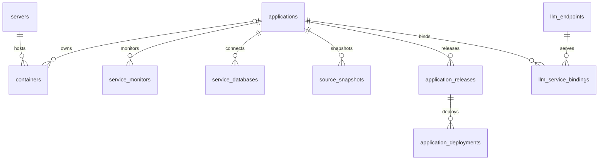
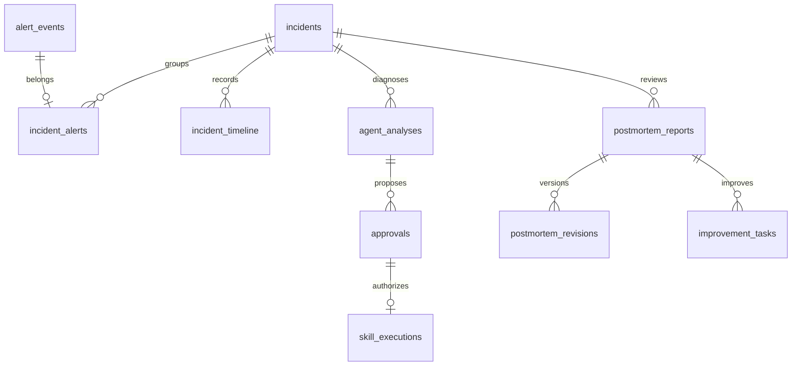

# SentinelOps 数据库现状梳理

核对时间：2026-10-25 13:32:53（北京时间）。范围为当前本机主平台数据库、源码模型和迁移；数据库检查全部在只读事务中执行。

当前主库有 **68 张业务表 + 1 张 Alembic 版本表**。数据库已应用 `0033_inspection_sources`，与当前源码的迁移 head 一致；Alembic 模型比对（开启字段类型比较）返回 0 项差异。

## 运行与存储边界

| 项目 | 当前情况 |
| --- | --- |
| 主数据库 | `ops_platform`，`public` schema |
| 数据库版本 | PostgreSQL 17.11，pgvector 0.8.7 |
| 本机入口 | `127.0.0.1:5432` |
| 容器 / Compose 项目 | `sentinelops-postgres-1` / `sentinelops` |
| 持久化卷 | `sentinelops_postgres_data` |
| 数据库大小 | 34,903,731 bytes，约 33.3 MiB，包含索引和数据库内部开销 |
| 时间配置 | 数据库会话 UTC；业务时间列为 `TIMESTAMP WITH TIME ZONE` |
| 模型规模 | 68 张表、939 个字段、140 个外键；模型声明 82 个索引，不含主键与唯一约束自动建立的索引 |
| 迁移 | 33 个迁移文件，唯一 head 为 `0033_inspection_sources` |

本机还运行一个独立 PostgreSQL 容器 `sentinelops-inspections-db`，端口 `25436`，初始化库名为 `sentinelops_inspections_test`。它不属于主平台 Compose 项目，本次没有进入该实例检查表结构。

主 PostgreSQL 实例内另有 **10 个名称以 `_test` 结尾的数据库**，以及维护库 `postgres`。测试库与主库按数据库隔离，但共用同一个 PostgreSQL 实例的资源。本次没有运行测试、迁移或清理。

| 数据类型 | 保存位置 | 当前边界 |
| --- | --- | --- |
| 业务配置、资产、事故、诊断、授权、执行、复盘和审计 | PostgreSQL | 平台的业务事实与任务状态 |
| 原始指标时序 | Prometheus | Compose 配置保留 35 天；PostgreSQL 保存派生结果、最近状态及取证快照 |
| 知识文档和向量 | PostgreSQL + pgvector | `knowledge_chunks.embedding` 为 `VECTOR(512)` |
| 源码文件内容 | `source_store` 卷 | PostgreSQL 保存快照清单、摘要和版本对应关系 |
| 归档文件 | `archives` 卷 | PostgreSQL 保存归档索引、摘要与处理状态 |
| 凭据主密钥 | 独立凭据文件 / secrets 卷 | 数据库保存加密凭据；恢复时需配套原主密钥 |
| 复盘邮件固定附件 | PostgreSQL | `postmortem_deliveries.attachment` 是 `BYTEA`，保存该次发送冻结的 PDF |

## 核心关系

业务服务的中心表是 `applications`，前端“服务”对应这里的记录。它同时承载服务用途、依赖和源码接入配置。

部署记录通过 `release_id` 固定发布版本，目标必须在 `container_id` 与 `llm_endpoint_id` 中二选一。业务服务与 LLM Endpoint 另有 `llm_service_bindings` 多对多关系，不要求每次关联都存在发布部署记录。

事故处理涉及以下外键关系；这张图表示记录关联，具体任务何时发起由业务流程控制。

- `alert_events` 是告警实例，`incidents` 是业务事故，`approvals` 是执行授权，三者分别存储。`incidents` 没有直接的 `application_id` 字段，服务归属需结合关联告警及资产上下文判断。
- 私有诊断会话按 `analysis_conversations → analysis_runs / analysis_messages / analysis_events` 保存；候选被正式采用后，`analysis_runs.adopted_analysis_id` 指向 `agent_analyses`。
- 巡检按 `inspection_plans → inspection_runs → inspection_items → inspection_reviews` 保存。`inspection_plans.application_id` 可为空，支持独立巡检；主源和关联源配置保存在 JSON 字段中。
- 正式诊断、复盘和执行都有冻结配置、证据或绑定快照，历史材料不会仅依赖当前资产配置重新解释。

## 全部业务表

“未软删除”仅表示该表自身的 `deleted_at IS NULL`，不等于业务正在运行、会话仍有效或页面最终可见数量。父记录的软删除、授权范围、有效期和业务状态仍会影响查询结果。

### 1. 身份与登录（3 张）

模型文件：`backend/app/models/auth.py`。

| 表名 | 职责 | 主要字段 | 总记录 | 未软删除 |
| --- | --- | --- | ---: | ---: |
| `roles` | 角色定义；用户关联单一角色 | code、name | 3 | 3 |
| `users` | 用户、密码哈希、启停状态和通知邮箱 | username、password_hash、role_id、is_active | 12 | 1 |
| `auth_sessions` | 刷新令牌会话、过期与撤销记录 | user_id、refresh_jti_hash、expires_at、revoked_at | 365 | 311 |

### 2. 主机与容器资产（3 张）

模型文件：`backend/app/models/resources.py`。

| 表名 | 职责 | 主要字段 | 总记录 | 未软删除 |
| --- | --- | --- | ---: | ---: |
| `ssh_credentials` | SSH 凭据的加密内容 | name、auth_type、encrypted_secret | 8 | 1 |
| `servers` | 服务器、采集地址及 SSH 主机身份 | host、credential_id、environment、monitoring_enabled | 18 | 1 |
| `containers` | 发现的容器、业务服务归属和镜像身份 | server_id、docker_id、application_id、status、identity | 916 | 368 |

### 3. 业务服务与源码发布（5 张）

模型文件：`backend/app/models/sources.py`。

| 表名 | 职责 | 主要字段 | 总记录 | 未软删除 |
| --- | --- | --- | ---: | ---: |
| `applications` | 业务服务主档，同时保存 Git/SVN/本地源码接入配置 | code、name、purpose、depends_on、git_url、svn_url | 2 | 2 |
| `source_snapshots` | 源码同步任务及固定版本的文件清单 | application_id、status、git_commit、svn_revision、manifest | 3 | 3 |
| `application_releases` | 业务服务发布版本及镜像、源码对应关系 | application_id、version、snapshot_id、image_id | 2 | 2 |
| `application_deployments` | 发布版本在容器或 LLM Endpoint 上的部署历史 | application_id、release_id、container_id、llm_endpoint_id、binding | 4 | 3 |
| `source_audit_logs` | 源码接入和发布相关操作审计 | application_id、user_id、action、detail | 32 | 32 |

### 4. 服务监测与数据库接入（6 张）

模型文件：`backend/app/models/monitoring.py / service_databases.py / llm.py / operations.py`。

| 表名 | 职责 | 主要字段 | 总记录 | 未软删除 |
| --- | --- | --- | ---: | ---: |
| `service_monitors` | 服务探测配置及最近探测状态、证据 | application_id、protocol、target、assertions、last_evidence | 4 | 2 |
| `service_databases` | 外部业务数据库只读连接、白名单及结构缓存 | application_id、engine、encrypted_config、allowed_tables、schema_cache | 1 | 1 |
| `llm_endpoints` | LLM 接口、加密 API Key 及最近探测状态 | provider、base_url、model、encrypted_api_key、probe_enabled | 2 | 1 |
| `llm_service_bindings` | 业务服务与 LLM Endpoint 的多对多关联 | application_id、llm_endpoint_id、purpose | 1 | 1 |
| `service_objectives` | 服务目标及最近一次评估结果 | application_id、monitor_id、kind、target、evaluation | 0 | 0 |
| `service_operations_policies` | 服务恢复稳定窗口与响应策略 | application_id、recovery_seconds、response_config | 0 | 0 |

### 5. 告警与预测（5 张）

模型文件：`backend/app/models/alerts.py / predictions.py / evaluation.py`。

| 表名 | 职责 | 主要字段 | 总记录 | 未软删除 |
| --- | --- | --- | ---: | ---: |
| `alert_rules` | 监控、LLM 和预测告警规则 | code、service_monitor_id、server_id、metric、threshold、auto_diagnose | 36 | 9 |
| `alert_events` | 告警实例、规则快照、确认与恢复核验证据 | fingerprint、rule_id、status、starts_at、recovery_status、rule_snapshot | 2,706 | 40 |
| `prediction_tasks` | 预测对象、指标、阈值和运行调度 | server_id、container_id、llm_endpoint_id、metric、next_run_at | 6 | 2 |
| `prediction_results` | 预测运行记录、派生曲线、质量与异常证据 | task_id、status、config、quality、horizons、anomalies | 328 | 322 |
| `prediction_outcomes` | 各预测时间跨度的实际结果核验 | result_id、horizon_hours、status、observation | 921 | 921 |

### 6. 事故与响应（5 张）

模型文件：`backend/app/models/incidents.py / operations.py / notifications.py`。

| 表名 | 职责 | 主要字段 | 总记录 | 未软删除 |
| --- | --- | --- | ---: | ---: |
| `incidents` | 事故状态、负责人、恢复及关闭快照 | status、severity、assignee_id、closure、merged_into_id | 73 | 17 |
| `incident_alerts` | 事故与告警实例的关联；每条告警最多归属一个事故 | incident_id、alert_event_id | 2,390 | 35 |
| `incident_timeline` | 事故过程中的逐条事件和人工操作记录 | incident_id、event_type、occurred_at、actor_id、content | 8,139 | 8,139 |
| `incident_relations` | 事故相关、依赖和复发关系及人工判定 | incident_id、related_incident_id、kind、status、evidence | 0 | 0 |
| `incident_responses` | 事故响应时限、接单及升级记录 | incident_id、snapshot、due_at、accepted_at、escalated_at | 1 | 1 |

### 7. AI 诊断与私有会话（6 张）

模型文件：`backend/app/models/diagnosis.py`。

| 表名 | 职责 | 主要字段 | 总记录 | 未软删除 |
| --- | --- | --- | ---: | ---: |
| `diagnosis_policy` | 自动诊断全局开关，单例配置 | id、enabled、configured_by | 0 | 0 |
| `agent_analyses` | 正式诊断任务、冻结上下文、证据及结论 | incident_id、status、source_context、database_context、evidence、result | 20 | 1 |
| `analysis_conversations` | 用户所属的事故诊断会话 | incident_id、owner_id、title、last_seq | 7 | 6 |
| `analysis_runs` | 会话内每轮运行、候选结论及正式采用结果 | conversation_id、status、candidate、adopted_analysis_id | 6 | 6 |
| `analysis_messages` | 会话消息及关联运行 | conversation_id、run_id、role、content、client_message_id | 22 | 22 |
| `analysis_events` | 会话流事件与可恢复的顺序编号 | conversation_id、run_id、seq、kind、data | 484 | 484 |

### 8. 审批、执行与修复交接（4 张）

模型文件：`backend/app/models/executions.py / repairs.py`。

| 表名 | 职责 | 主要字段 | 总记录 | 未软删除 |
| --- | --- | --- | ---: | ---: |
| `approvals` | 具体诊断和容器动作的人工授权 | analysis_id、container_id、status、binding、binding_hash、expires_at | 12 | 0 |
| `skill_executions` | 审批消费后的执行、前置检查与恢复验证 | approval_id、status、precheck、output、verification | 6 | 0 |
| `audit_logs` | 事故、审批、执行和复盘的受限审计 | incident_id、approval_id、execution_id、report_id、action、detail | 115 | 115 |
| `repair_handoffs` | 面向开发修复的冻结交接包及后续核验 | incident_id、analysis_id、application_id、packet、results、verifications | 0 | 0 |

### 9. 知识与发现市场（7 张）

模型文件：`backend/app/models/knowledge.py / market.py`。

| 表名 | 职责 | 主要字段 | 总记录 | 未软删除 |
| --- | --- | --- | ---: | ---: |
| `knowledge_documents` | 知识文档及适用服务、版本与有效期 | title、content、version、application_ids、index_status | 13 | 5 |
| `knowledge_chunks` | 文档分片与 512 维检索向量 | document_id、version、position、content、embedding | 15 | 5 |
| `knowledge_skills` | 受控知识 Skill 指引及适用范围 | code、content、version、enabled、application_ids | 8 | 8 |
| `market_categories` | 市场分类 | name、sort_order、enabled | 7 | 7 |
| `market_entries` | 市场条目及当前发布版本指针 | kind、owner_id、listed、published_revision_id | 11 | 11 |
| `market_entry_revisions` | 市场条目的草稿、提审和审核版本 | entry_id、number、status、category_id、content | 11 | 11 |
| `market_audit_logs` | 市场分类、条目与版本的审计记录 | user_id、entry_id、revision_id、category_id、action | 33 | 33 |

### 10. 复盘与改进任务（4 张）

模型文件：`backend/app/models/reports.py / improvements.py`。

| 表名 | 职责 | 主要字段 | 总记录 | 未软删除 |
| --- | --- | --- | ---: | ---: |
| `postmortem_reports` | 复盘生成任务、冻结事故材料及审核状态 | incident_id、status、snapshot、snapshot_hash、revision | 13 | 3 |
| `postmortem_revisions` | 复盘正文的版本记录 | report_id、revision、content、content_hash | 7 | 1 |
| `postmortem_deliveries` | 显式发送任务、固定收件人与冻结 PDF 附件 | report_id、revision、recipients、attachment、status | 3 | 0 |
| `improvement_tasks` | 复盘建议形成的分派、提交与验收记录 | report_id、report_revision、item_index、status、submission、decision | 0 | 0 |

### 11. 业务巡检（4 张）

模型文件：`backend/app/models/inspections.py`。

| 表名 | 职责 | 主要字段 | 总记录 | 未软删除 |
| --- | --- | --- | ---: | ---: |
| `inspection_plans` | 可独立创建的巡检计划、主源与关联源、规则和游标 | application_id、source_kind、source_config、related_sources、rules、watermark | 3 | 3 |
| `inspection_runs` | 一次巡检运行及配置快照、时间窗口和汇总 | plan_id、plan_version、status、snapshot、window_start、window_end | 7 | 7 |
| `inspection_items` | 逐业务对象的检查、证据及 Agent 评审结果 | run_id、record_id、record_version、identity_hash、verdict、agent_result | 11 | 11 |
| `inspection_reviews` | 人工对单条巡检结果的复核 | item_id、reviewer_id、verdict、comment | 4 | 4 |

### 12. 通知与运行控制（5 张）

模型文件：`backend/app/models/notifications.py`。

| 表名 | 职责 | 主要字段 | 总记录 | 未软删除 |
| --- | --- | --- | ---: | ---: |
| `notification_policy` | 通知全局策略 | managed、email_enabled、configured_by、version | 0 | 0 |
| `notifications` | 站内通知、已读状态和邮件发送状态 | user_id、resource_kind、resource_id、dedupe_key、mail_status | 2 | 2 |
| `maintenance_windows` | 维护或静默窗口，目标按类型和 ID 表示 | scope_kind、scope_id、kind、starts_at、ends_at | 0 | 0 |
| `alert_inhibitions` | 规则间告警抑制关系 | parent_rule_id、child_rule_id | 0 | 0 |
| `operations_audit_logs` | 跨资源运维操作审计 | user_id、resource_kind、resource_id、action、detail | 25 | 25 |

### 13. 诊断评审与回放评估（3 张）

模型文件：`backend/app/models/evaluation.py`。

| 表名 | 职责 | 主要字段 | 总记录 | 未软删除 |
| --- | --- | --- | ---: | ---: |
| `diagnosis_reviews` | 人工确认诊断结论和根因 | analysis_id、reviewer_id、verdict、confirmed_cause | 0 | 0 |
| `evaluation_cases` | 从诊断冻结的评估案例及版本 | family_id、version、analysis_id、snapshot、human_label | 0 | 0 |
| `evaluation_runs` | 案例回放运行、输出和人工复核 | case_id、provider_kind、status、result、review | 0 | 0 |

### 14. 用量、成本与归档（6 张）

模型文件：`backend/app/models/governance.py`。

| 表名 | 职责 | 主要字段 | 总记录 | 未软删除 |
| --- | --- | --- | ---: | ---: |
| `model_usage` | 模型调用与业务用量的去重记录 | dedupe_key、application_id、resource_kind、model、input_tokens、output_tokens | 206 | 206 |
| `usage_cursors` | 业务服务用量采集位置 | application_id、source_epoch、observed_until | 1 | 1 |
| `model_prices` | 按模型、币种和生效时间的 Token 单价 | model、currency、effective_at、input_per_million、output_per_million | 0 | 0 |
| `usage_budgets` | 全局或服务级月度预算 | application_id、purpose、currency、monthly_limit、enabled | 0 | 0 |
| `retention_plans` | 经人工确认的数据保留与归档计划 | status、candidates、result、confirmed_by、confirmed_at | 0 | 0 |
| `archive_records` | 已归档资源、摘要及空间释放记录 | plan_id、resource_kind、resource_id、sha256、metadata_snapshot | 0 | 0 |

### 15. 平台自身状态（2 张）

模型文件：`backend/app/models/platform.py / operations.py`。

| 表名 | 职责 | 主要字段 | 总记录 | 未软删除 |
| --- | --- | --- | ---: | ---: |
| `backup_records` | 平台登记的备份或恢复演练证据 | kind、backup_id、artifacts、completed_at、verification | 0 | 0 |
| `worker_heartbeats` | 各后台 worker 最近心跳与状态 | id、observed_at、state、detail | 7 | 7 |

`alembic_version` 为额外的迁移维护表，当前 1 条记录，也包含三个时间字段，不计入上述 68 张业务表。

## 通用字段与约束

- 所有业务表包含 `created_at`、`updated_at`、`deleted_at`。创建和更新时间非空且默认 `now()`，删除时间可空；包括版本表在内的 69 张表均有 `set_updated_at()` 更新触发器。
- 多数表以 UUID 为主键；`diagnosis_policy`、`notification_policy` 使用整数主键，`worker_heartbeats` 使用字符串主键。
- 业务软删除依赖查询显式排除 `deleted_at`，不是所有 SQL 都会自动过滤。`auth_sessions` 还需核对 `expires_at`、`revoked_at`，不能把未软删除数当成有效登录数。
- 模型中有 96 个 JSON 字段，用于配置、依赖、证据、结果和快照。`depends_on`、`application_ids` 以及 `resource_kind + resource_id` 等关联并非逐项数据库外键，需要业务层校验。
- `incident_alerts.alert_event_id` 唯一，避免一个告警实例重复归属多个事故；`skill_executions.approval_id` 唯一，限制一份审批对应一次执行。
- 部分唯一索引用于限制并发任务：每事故一个活动正式诊断、每会话一个活动运行、每容器一个活动执行、每巡检计划一个活动运行。审批还通过 `binding`、`binding_hash` 和过期时间固定授权内容。
- `inspection_items.identity_hash` 唯一，`(plan_id, record_id, created_at)` 索引用于对象历史查询；`knowledge_chunks` 当前没有 HNSW/IVFFlat 近似向量索引，采用现有精确检索路径。
- 原生唯一约束与“仅未删除记录唯一”的部分索引并存。例如用户名、服务 code 等唯一约束仍覆盖软删除记录；不能统一假定删除后名称立即可复用。

## 当前数据反映的使用情况

以下数量来自表清单快照；状态分组在随后一次只读事务中核对，运行中的任务可能使数量变化。

| 对象 | 当前记录状态 |
| --- | --- |
| 服务与资产 | 2 个未软删除业务服务、1 台服务器、368 条容器记录；容器状态为 running 23 条、stopped 345 条 |
| 监测与接入 | 2 个未软删除服务监测、1 个 LLM Endpoint、1 个业务数据库接入、9 条告警规则 |
| 告警与事故 | 未软删除告警 40 条、事故 17 条；事故状态为 open 3、recovered 13、closed 1 |
| 预测 | 2 个未软删除预测任务、322 条未软删除预测结果；核对时这些结果均为 completed |
| 正式诊断与执行 | 未软删除正式诊断 1 条；审批、执行历史分别有 12、6 条，但这些审批和执行均已软删除 |
| 业务巡检 | 3 个计划、7 次运行、11 条结果、4 条人工复核；运行状态为 completed 6、partial 1 |
| 巡检结论 | supported 3、contradicted 5、needs_review 2、unassessable 1 |
| 知识与复盘 | 5 篇未软删除知识文档、8 个知识 Skill、3 份未软删除复盘主记录 |
| 运行与用量 | 7 条 worker 心跳记录、206 条模型/业务用量记录 |

68 张业务表合计 **17,032 条记录，其中 5,830 条软删除**。`incident_timeline` 有 8,139 条记录，是记录数最多的表；`alert_events` 总大小约 7.38 MiB，是当前占用最大的业务表（含索引和 TOAST）。这些是历史数据量，不能换算为正在发生的事故或运行任务数。

目前为空的 17 张业务表为：

`alert_inhibitions`、`archive_records`、`backup_records`、`diagnosis_policy`、`diagnosis_reviews`、`evaluation_cases`、`evaluation_runs`、`improvement_tasks`、`incident_relations`、`maintenance_windows`、`model_prices`、`notification_policy`、`repair_handoffs`、`retention_plans`、`service_objectives`、`service_operations_policies`、`usage_budgets`。

空表只表明当前库没有相应记录。特别是 `backup_records` 为空，只能说明平台未登记备份证据，不能据此判断外部是否存在备份；策略表为空时应结合代码默认值判断功能状态。

## 迁移演进与文档差异

| 迁移范围 | 主要变化 |
| --- | --- |
| 0001–0007 | 基础时间触发器、账号、资源、告警、LLM、预测与事故 |
| 0008–0012 | 知识与 AI 诊断、审批执行、复盘、监控恢复核验、私有分析会话 |
| 0013–0016 | 源码、冻结诊断上下文、修复交接及事故关闭快照 |
| 0017–0024 | 容器与业务服务、发现市场、LLM 关联、自动诊断、服务监测、SVN 和只读数据库接入 |
| 0025–0031 | 服务目标、稳定恢复与影响关联、响应通知、效果评估、知识改进、平台健康、成本与归档 |
| 0032 | 业务巡检的计划、运行、结果和人工复核 |
| 0033 | 巡检可不关联服务、增加多源配置及对象历史索引 |

当前源码 `backend/app/services/system.py` 的就绪版本与数据库均为 `0033_inspection_sources`。以下旧说明仍有历史口径，本次只记录差异：

- `README.md`“数据库迁移”段仍写到 `0016_incident_closure`，后面的复盘升级说明也保留旧版本；首页升级说明已经写为 0033。
- `docs/backend/项目组织与迁移.md` 仍有“42 个模型”和就绪版本 0031 的表述，当前实际为 68 张业务表、就绪版本 0033。
- `README.md` 早期监控入口说明写 Prometheus 保留 15 天，后续预测说明和当前 Compose 均为 35 天。

## 本次核对结果与边界

| 检查 | 结果 |
| --- | --- |
| 模型表与实际业务表集合 | 一致；仅额外存在预期的 `alembic_version` |
| 列名、可空性 | 无差异 |
| Alembic 自动结构比对，包含类型比较 | 0 项差异；未开启 server default 自动比较 |
| 三个时间列的类型、默认值和可空性 | 69 张表全部符合本项目约定 |
| 更新时间触发器 | 69 张表全部具备 |
| 归档引用保护触发器 | 14 张表具备 `guard_archived_reference()` |
| 当前数据库迁移与源码 head | 都为 `0033_inspection_sources` |

本次确认结构与数据概况，不据此认定全部业务约束、权限、任务恢复和外部联调均已通过。没有修改数据库，没有运行会清空数据库的测试，没有连接已登记的外部业务数据库，也没有清理历史或测试数据。

源码入口：`backend/app/models/`、`backend/app/db/base.py`、`backend/app/db/session.py`、`backend/migrations/versions/`、`compose.yaml`。

本机只读快照位于 `.local/database-schema-20261025.json` 和 `.local/database-live-20261025.json`，包含结构与数量，不包含凭据或业务记录正文。
