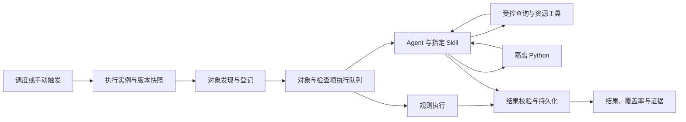

# SentinelOps 智能巡检模块落地设计方案

日期：2026-10-29。状态：第一、二阶段已完成源码与本地隔离验收，见[第一阶段](智能巡检第一阶段实施与验收.md)、[第二阶段](智能巡检第二阶段实施与验收.md)。第三阶段已实现中断识别、取消、完整发现范围内的补检与试运行清理，并完成本机迁移回退演练，见[第三阶段](智能巡检第三阶段实施与验收.md)。现有旧 Agent 任务已按用户明确选择转换为独立检查，并完成真实模型语义小样本；未完成发现的续扫和真实业务规模验证仍待完成。

依据：用户提供的《SentinelOps 智能巡检模块需求说明 V1.0》、仓库巡检源码和文档，以及文末列出的官方资料。第 2 节记录设计形成时的源码基线；后续完成情况以各阶段验收文档为准。

## 1. 产品决策

保留需求中的主线：**同一个巡检任务可以包含规则检查和 Agent 检查，平台统一管理对象、执行、结果和证据。**

日常使用围绕三个问题组织：检查什么、依据什么判断、什么时候执行。用户不需要先理解 records/agent 两套运行模式，也不需要逐次编写脚本。

职责划分如下：

- 平台负责对象登记、分页、任务调度、权限、执行预算、结果校验、进度统计和恢复。
- 规则负责明确条件的确定性判断，不调用 LLM。
- Agent 依据 Skill 自主选择补充数据、生成和执行 Python、修正检查过程，输出有证据的结论。
- Skill 提供检查方法和业务依据；连接、工具和权限由平台配置，Skill 内容不能扩大授权。

首期定位为可长期运行的只读业务巡检。继续使用现有模块化单体、后台 worker、Harness 和 Docker 沙箱。保持现有审批执行、告警与事故职责，不引入工作流画布、额外 Agent 框架或通用编排平台。

### 1.1 对原需求的具体调整

| 原设想 | 落地决策 | 对使用的影响 |
| --- | --- | --- |
| 巡检任务、记录、连接三个入口 | 保留三个入口，默认进入巡检任务；连接作为次级配置入口 | 首屏围绕待管理的任务和异常 |
| 连接包含请求或查询逻辑 | 区分连接与可复用查询；前端仍在连接管理中一起配置 | 一个凭据可服务列表、详情等多个查询，避免重复维护密钥 |
| 任务选择规则模式或 Agent 模式 | 类型下沉到检查项，任务只配置一次对象和执行安排 | 可以直接添加“字段规则”和“材料一致性检查” |
| Agent 自主完成所有分页和对象发现 | 通过平台工具发现和登记对象，分页结束与覆盖率由平台记录 | Agent 可以继续取数，平台也能识别漏检 |
| 一个对象产出多个结果 | 按“对象 × 检查项”保存结果；一个结果允许多个问题发现 | 多个问题不会被压缩为一句正常或异常 |
| 必须具备代码执行能力 | 首期必须具备隔离 Python；不强制每轮调用，不要求用户提供脚本 | 需要计算时可生成代码，简单检查可直接判断 |
| 支持数据库查询 | 首期支持 PostgreSQL/MySQL 的已登记参数化只读查询和现有选表取字段方式 | 用户可以配置 SQL，Agent 使用查询标识和参数，不直接执行自由 SQL |
| 支持多 Skill | 每个 Agent 检查项选择一个主 Skill，可附加指定的辅助 Skill；所有版本固定 | 同一 Agent 会话使用多份知识，不增加多 Agent 协作 |
| 暂停任务 | 暂停只停止后续调度；运行详情单独提供取消 | 用户调整日程时不会意外中断当前巡检；这是对现有行为的明确调整 |
| 部分完成后继续 | 新建关联原执行的继续实例，保留原记录 | 可以区分第一次检查与后续补检 |
| 事件触发 | 首期复用受鉴权 API 触发；自动订阅业务事件后置 | 不为巡检额外搭建消息总线 |
| 原始数据使用对象存储 | 首期数据库保存结构化结果，受管卷保存较大产物；按需接入对象存储 | 不新增必需基础组件 |
| 所有异常接入告警 | 首期支持查看和关联现有事件；自动告警按后续显式策略开启 | 避免每次巡检重复生成事故和通知 |

### 1.2 首期范围

首期必须完成原需求的九条验收标准，包括数据库多对象、同任务混合检查、Agent 动态取数与代码执行、试运行和周期执行。下文的实施阶段共同构成首期，不能把这些核心能力留到后续扩展。

首期支持手动、间隔、指定时间、Cron、鉴权 API 触发，固定对象与分页发现，检查集合的计算，以及未完成对象的补检。首期支持的附件是授权查询取得的文本/JSON 和 Skill 内资源。PDF、扫描件等资料若需要抽取或 OCR，应先接入明确的文件读取适配器；不能仅靠在 Skill 中写“读取附件”就视为支持。

后续再做自动事件订阅、更多数据库类型、复杂检查模板市场、任意依赖安装、跨任务编排和自动通知策略。它们不影响首期闭环。

## 2. 现有基础与真实缺口

当前已经有可复用的实现，无需整体重写。

| 能力 | 当前源码情况 | 本轮设计要补的内容 |
| --- | --- | --- |
| 任务与执行实例 | `InspectionPlan`、`InspectionRun` 已有版本、快照、调度和执行状态 | 检查项独立定义，增加试运行、复制与补检语义 |
| 数据源 | `InspectionDataSource` 复用 HTTP 配置，数据库凭据保存在 `ServiceDatabase` | HTTP 连接与查询分离、普通分页适配、详情查询、登记 SQL |
| 规则 | 必填、等值、字段比较、数值范围及数组路径 | HTTP 状态/耗时、字符串匹配、条件组与集合检查 |
| 规则与 Agent 组合 | records 模式支持规则加 Agent 分析 | 当前对象健康结果有规则优先语义，不能直接代表多个独立检查项的合并结论 |
| Agent 自主检查 | `workflow.py` 有授权 API、Python 工具、证据引用校验 | 数据库工具、对象登记、逐项增量提交、独立检查项结果和资源文件读取 |
| Python 执行 | 现有独立 broker 和临时受限容器，无宿主机回退 | 复用；完善代码产物、每次尝试和输入输出引用 |
| 对象覆盖 | records 模式有游标；Agent 模式有 `complete` 和 findings | Agent 的 `complete` 不能独立证明发现了全部对象，需平台发现台账 |
| 调度与并发 | 已有手动、间隔、Cron、单次、事件入口；worker 有单实例锁 | 保留防重入，增加对象/检查项执行台账；不能只增加并发表单就宣称支持并发 |
| UI | 已拆成任务、执行、数据源页面，但任务编辑仍是模式选择和较大抽屉 | 创建使用完整页面，任务采用服务分组列表，执行详情围绕异常和未覆盖范围 |
| Skill | `KnowledgeSkill` 保存正文、scripts 和版本 | 补齐标准目录导入、references/assets、按需读取及兼容校验 |

核对入口：

- [模型](../../backend/app/models/inspections.py)、[结构定义](../../backend/app/schemas/inspections.py)。
- [任务配置](../../backend/app/services/inspections/plans.py)、[执行流程](../../backend/app/services/inspections/runtime.py)、[结果解释](../../backend/app/services/inspections/outcomes.py)。
- [Agent 接入](../../backend/app/services/inspections/agent.py)、[自主检查工具](../../backend/app/services/inspections/workflow.py)、[Python 适配](../../backend/app/integrations/inspection_python.py)。
- [任务列表](../../frontend/src/features/inspections/pages/PlanList.vue)、[任务编辑](../../frontend/src/features/inspections/components/PlanEditor.vue)、[当前巡检说明](巡检中心.md)、[现有沙箱约定](Agent-Skill自主巡检.md)。

## 3. 从一次真实使用组织功能

### 3.1 示例：每晚检查项目材料

以下对象和数量仅用于说明设计，不是实测结果。

用户希望每天 02:00 检查某服务下全部待审项目，判断材料是否齐全、金额是否一致、证书是否有效。

1. 管理员在连接管理登记业务 API，配置认证一次；再登记“列出待审项目”“项目详情”“证书详情”三个只读查询。它们共用连接。
2. 创建“项目材料夜间巡检”，选择服务、环境和“从待审项目查询发现对象”。把 `project_id` 映射为对象编号，把 `project_name` 映射为名称；选择分页方式。
3. 添加“必需字段完整”规则检查项，以及“材料与金额一致性”Agent 检查项。后者选择业务 Skill 和上述授权查询。
4. Skill 给出金额口径、材料适用条件和证书有效性依据。Agent 可读取详情、发现缺证后继续查询，生成 Python 按指定精度计算金额，再逐对象提交结论。标准不明时列出缺口。
5. 用户先试运行最多 3 个对象，查看映射数据、工具调用、代码输出和结果。试运行没有问题后，保存并启用每天 02:00 的日程。
6. 次日打开任务：显示“已完成 · 发现异常 3 个对象”；另有未判定则明确标出。打开后优先看到异常项目、原因和证据。

如果已发现 120 个项目，只完成 100 个，页面显示“部分完成 · 已检查 100/120 · 20 个未完成”。如果分页尚未结束，总量没有可靠依据，则显示“已发现 120 · 已检查 100 · 发现未完成”，不能显示 100% 或推断只有 20 个剩余。

### 3.2 示例：数据库订单检查

管理员复用现有只读数据库连接，登记带稳定排序和参数的待检查订单查询。用户添加“金额非负”规则检查项和“行项目合计与订单总额一致”检查项。可配置的确定性条件直接使用规则；需要复杂计算时使用 Agent 与隔离 Python。

Agent 通过订单编号调用已授权的订单明细查询。数据库凭据由平台读取适配器使用，Python 仅收到脱敏后的查询结果。

### 3.3 示例：单个 API 可用性

固定一个 API 对象，规则判断状态码和响应时间，不配置 Skill，不调用模型。状态码不符合明确规则属于检查完成且发现异常；网络读取失败且没有获得规则所需观测时，记录执行问题和未判定。若明确配置的是“是否能够连通”检查，连接失败可以是该可用性规则的确定性失败。必须由检查类型定义，不能全局把所有取数失败映射为业务异常。

## 4. 用户看到的配置模型

### 4.1 任务

任务保存名称、描述、服务、环境、对象配置、检查项、日程和执行预算。一个任务对应一个主对象集合；多个来源可为同一对象提供补充资料。对象类型不同、执行频率不同或需要不同权限的检查，拆成同服务下的不同任务。

任务保存默认暂停，保存与启用分开。复制产生暂停的新任务，保留可引用的配置，不复制执行历史、对象进度或密钥明文。沿用既有服务关联能力，独立任务显示在“独立巡检”分组。

### 4.2 连接与查询

| 概念 | 用户配置 | 不应包含 |
| --- | --- | --- |
| HTTP 连接 | 服务/环境、基础地址、认证、启停与允许的访问范围 | 某次巡检发现了哪些对象 |
| 数据库连接 | 复用现有数据库连接、只读账号、TLS、授权表列 | Agent 动态提供的凭据 |
| 可复用查询 | 连接引用、列表/详情用途、方法或只读 SQL、参数 Schema、响应映射、分页、上限 | 调度和巡检结论 |

配置界面提供“测试连接”和“预览查询”两个动作。前者确认认证与基本可达性；后者验证实际参数、分页、对象映射和返回数据。连接可用不代表业务查询可用。

HTTP 支持固定 GET 和显式登记为只读的 POST 查询；工具参数仅包含查询 ID 和白名单参数。SQL 优先使用现有选表选列方式；复杂需求允许管理员登记参数化 SELECT，配置时校验语法、表列、函数和参数，运行时再叠加只读事务、只读账号、超时与行数限制，不能仅判断 SQL 是否以 SELECT 开头。首期不开放 Agent 生成任意 SQL。

### 4.3 检查对象

固定对象支持手工指定一个或多个稳定编号，以及必要的输入字段；需要更多资料时绑定详情查询。动态对象来自已登记查询。

发现配置包含列表位置、编号字段、名称字段、稳定排序和分页方式。首期支持 cursor、page/page_size、offset/limit；每种方式必须配置明确的结束条件。禁止依赖“让 Agent 自己猜最后一页”。

- 对象唯一键在任务范围内稳定，并包含来源命名空间；不能以数组位置作为补检依据。
- 无稳定编号的单个响应可以配置一个固定对象；动态列表缺稳定编号时阻止启用，提示补充映射。
- 重复页、重复对象编号、游标不前进分别记录；不能通过静默去重掩盖分页未完成。
- 记录发现、纳入、排除、完成、未完成的数量及原因。业务筛选必须有配置或证据；Agent 不能自行排除难以检查的对象。
- 有快照令牌/更新时间窗口时固定本轮范围；没有源端快照时标明“按读取时间观察”，不宣称全局一致快照。

### 4.4 检查项

每项包含稳定 `check_id`、名称、启用状态、类型、检查范围、判断配置、异常级别。必需执行的检查才计入覆盖率；禁用项不计入，并在运行快照中保留。

| 类型 | 面向用户的配置 |
| --- | --- |
| 规则检查 | 字段或 HTTP 指标、条件、AND/OR 条件组、异常级别、依据 |
| Agent 检查 | 检查要求、主/辅助 Skill、业务参数、授权查询/文件、运行预算 |

检查范围默认“逐对象”。金额总计、重复项、统计分布等使用“本次对象集合”；集合检查只执行一次，其结果单独统计，发现的问题可以关联多个对象。它仍使用同一套检查项和结果，不引入编排节点。

集合计算必须确认输入覆盖完整范围，并遵守沙箱与证据大小限制。适合分页累计的确定性计算可在平台侧分批处理并保存输入引用；需要完整输入但超过上限的 Agent 计算明确报告未完成，不能用抽样结果代替全量统计。

规则界面使用条件编辑器，首期支持一组 AND 或 OR；复杂嵌套逻辑留给明确的后续需求。字符串先提供包含/前缀/后缀/等值，若支持正则需限制长度与执行时间。缺字段、类型错误和数值单位不符不能自动转为通过；AND/OR 对 unknown 使用明确的三值逻辑：AND 中出现 fail 则 fail，OR 中出现 pass 则 pass，其余不足以决定时为 unknown。

HTTP 查询适配器应保留状态码、耗时等观测元数据，再按检查配置判断；不能像当前部分查询工具一样，在非 200 时只返回通用错误并丢失判断依据。认证失效、业务响应异常和传输失败分别记录，供不同检查类型使用。

同任务的检查项默认独立执行，单项失败不阻止其他项。需要业务依赖的复杂流程封装在一个 Skill 中，首期不做检查项之间任意依赖。

## 5. Agent 的实际执行方式



平台的固定流程管理执行和审计，Agent 内部保留工具循环：读 Skill → 获取资料 → 判断缺口 → 补充查询或执行代码 → 核验 → 提交结果。

### 5.1 工具清单

| 工具能力 | 输入与边界 |
| --- | --- |
| 读取 Skill | 指定 Skill 版本与允许的资源相对路径；按需读取 references、scripts、assets |
| 发现对象 | 已登记发现查询及允许参数；返回对象、游标、结束依据，并写入平台对象台账 |
| 获取对象资料 | 查询 ID、当前对象 ID 和参数；平台检查对象范围与连接范围 |
| 查询数据库 | 已登记查询 ID 与参数；无自由 SQL、无连接字符串 |
| 读取检查材料 | 已授权的材料引用；不允许任意 URL、宿主机路径或目录遍历 |
| 执行 Python | 动态代码或 Skill 脚本、证据引用、受限输入；无业务凭据和网络 |
| 提交检查结果 | 当前对象/集合、检查项、结构化结果、证据引用；平台校验后立即保存 |

对象发现可由平台启动，也可以由 Agent 在执行中调用；二者走同一发现与登记能力。按需查询证书详情通常补充当前对象的证据，不改变主对象清单。需要纳入新的主对象时，必须通过任务已授权的发现逻辑登记，不能靠最终回答追加对象编号。

一次会话可以处理小批对象，以支持对比、重复检测和减少调用成本；结果必须逐对象、逐检查项提交。批次长度只影响执行组织，不能改变对象级结果与恢复粒度。

### 5.2 Skill 的制作和使用

运维人员创建任务时选择现有 Skill，填业务参数即可。业务标准维护者在现有知识与 Skill 管理中维护 Skill，不另建一套巡检 Skill 库。

采用标准目录组织：

```text
project-material-inspection/
  SKILL.md
  references/
    judgment-basis.md
  scripts/
    amount-check.py
  assets/
    example-input.json
```

正文说明适用对象、查询用途、判断依据、缺失资料处理、需要计算的部分和结果示例。脚本用于复用常用计算，Agent 仍可根据本次资料生成临时代码。首期 Python 以现有标准库沙箱为基线，需要额外库的 Skill 在启用前显示不兼容，不能运行时自行安装。

目录导入时检查 frontmatter、文件大小、路径和引用；不执行导入包内脚本或安装钩子。每个检查项固定主/辅助 Skill 的版本和内容摘要。辅助 Skill 只补充方法与资料；冲突的判断标准在配置/试运行阶段解决，不能让模型临时猜测优先级。

标准格式不等于执行授权。`allowed-tools` 等元数据只能作为兼容信息；平台仍按任务授予的工具范围裁剪。该字段在官方规范中仍属实验性。[Agent Skills 规范](https://agentskills.io/specification)

### 5.3 代码与执行预算

复用现有 Python broker：独立临时容器、非 root、无网络、无宿主机挂载、只读根目录、CPU/内存/进程/时间/输出限制。沙箱不可用则该项执行错误，不能回退到 API 主进程或宿主机。

保存生成代码正文、摘要、输入证据引用、运行环境版本、stdout/stderr、退出状态和结构化输出。代码不能只保留摘要，否则无法复核具体计算。保存前检查并脱敏敏感信息；限制输入、代码和产物大小。

模型使用现有 Agent 配置中“巡检”模块的通道与用量统计，不在任务中重复配置模型密钥。界面高级设置展示实际时间、模型请求、工具调用和对象上限。代码修正与模型重试共享该项总预算，不能每次重试重置预算。

首期建议缺省值：每批 10 个对象、试运行 3 个对象、单任务一个活跃实例、Agent 会话并发 1。部署管理员设置全局硬上限，用户参数不能超过它。现有沙箱的 8 秒单次代码墙钟、128 MiB 等限制继续沿用；现有单会话工具/证据上限继续生效。大任务通过多个受限会话和平台台账完成，不把所有对象塞进一个模型上下文。最终缺省值需由真实任务耗时和模型成本校准。

## 6. 结果、状态与覆盖率

### 6.1 三个独立维度

| 维度 | 取值 | 回答的问题 |
| --- | --- | --- |
| 执行状态 | 排队、运行、完成、部分完成、失败、取消 | 这次程序执行到了哪里 |
| 检查结论 | pass、fail、unknown | 按本项依据是否满足要求 |
| 覆盖情况 | 发现是否完成、已完成/应执行检查数、未完成原因 | 是否覆盖了本轮应检查范围 |

`completed` 表示发现已完成且全部应执行检查正常结束；检查结果允许为 fail，也允许在明确记录资料不足时为 unknown。`partial` 表示存在执行错误、预算跳过、未处理对象或未结束的发现；启动失败或尚无有效完成结果即遇到致命执行问题时使用 failed。用户取消统一显示 cancelled，并保留已完成结果和覆盖率。

Schema 不合格、工具失败、代码失败、预算耗尽不能当作业务通过。对应执行尝试标记错误；该应执行项在结论汇总中为 unknown，覆盖率中为未完成。Agent 正常提交“资料不足、无法判定”可以是已完成的 unknown，界面要与执行错误区分。

### 6.2 统一结果结构

建议平台保存如下结构；平台补充 `run_id`、版本、执行时间、尝试 ID 和审计身份，Agent 不能自行指定这些字段：

```json
{
  "object_id": "project:P1001",
  "check_id": "material-consistency",
  "scope": "object",
  "status": "fail",
  "severity": "warning",
  "summary": "项目总额与明细合计不一致",
  "details": "按配置口径计算后存在差额。",
  "findings": [
    {
      "code": "amount_mismatch",
      "summary": "总额与明细合计相差 10 元",
      "evidence_ids": ["e12", "e13"]
    }
  ],
  "evidence_ids": ["e12", "e13"],
  "metrics": {"difference_cny": 10},
  "artifacts": ["artifact:amount-check-code"]
}
```

`severity` 对 pass/unknown 可为空；fail 的严重程度受检查项配置约束，不由模型任意升级。集合结果使用系统定义的集合标识，展示为集合检查，不混入业务对象数。`execution_ref` 由平台绑定对应尝试及轨迹。

结果校验包括 Schema、对象归属、检查项归属、重复提交、证据成功状态、证据所属对象或授权集合、产物范围。全局标准资料允许被多个对象引用，项目 A 的详情不能充当项目 B 的事实证据。通过 Schema 和引用校验只能说明格式与来源有效，不能证明判断正确；还需业务样例与人工复核。

### 6.3 汇总规则

对象结论按所有启用检查项合并：有 fail 则异常；没有 fail 但有 unknown 或未执行则未判定；全部 pass 才正常。异常对象同时存在未完成检查时，保留“异常 + 未完成”的覆盖状态。

任务整体同样有 fail 则显示“发现异常”，并同时显示覆盖不足。规则通过不能覆盖 Agent 检查失败，Agent 的正常描述也不能覆盖规则失败。保留原有人工复核及原始结果，复核不能重写运行时证据。

展示两套计数，避免把三个问题误算成三个对象：

- 对象：正常、异常、未判定；每个对象只计一次。
- 检查：已完成/应执行，以及异常检查数；集合检查单列。

已完整发现且确实没有对象时显示“无检查对象”，检查结论为 unknown/no_objects；如业务明确要求“待处理记录必须为零”，应配置集合计数规则，由该规则给出结论。取数失败时不能显示“无对象”。

只有发现已结束、所有应执行检查完成且全部 pass，才显示“本轮全部通过”。只有总量可靠时显示百分比；否则显示已发现、已完成和“仍在发现”。

## 7. 调度、取消与继续执行

每次触发建立独立执行实例，保存任务、检查项、查询、Skill、业务参数及执行预算快照；凭据只保存引用与版本，不复制解密后的值。

- 同任务一个活跃实例。手动重复点击进入已有实例；定时重叠记录本次触发被合并/跳过，避免形成无限积压。
- 平台停机错过多个调度点时，恢复后最多补一次，并记录错过范围；首期不做历史时点逐次回放。
- 调度按配置时区计算，界面预览下三次时间；持久化时间统一 UTC。
- 暂停只停止新触发，保留运行中的实例。停用连接、撤销授权是安全操作：后续工具调用立即停止，受影响项记录原因。
- 编辑任务形成新版本。普通配置变更供下一次执行使用；旧实例继续固定快照。安全撤权和连接停用仍立即生效。源配置发生不兼容变更时阻止继续读取，不能把新地址和旧认证静默混用。
- 取消先进入停止中，停止派发新项；等待或终止在途工具/容器，最终确认取消。晚到结果按实例状态校验，不能覆盖最终记录。

失败重试仅针对明确的暂时性读取或基础设施错误，最多使用既有 0–3 次配置并退避。业务 fail 不重试。代码可由 Agent 在预算内修正；每次失败与修正留痕。结果格式错误可在预算内要求修正一次，仍失败就记录执行错误。

继续执行不恢复一段不可验证的模型思考过程，而是读取平台台账，重新建立会话，处理尚未完成的对象与检查项。

1. 创建新的执行实例，保存 `resume_of_run_id`，沿用原任务版本、对象清单和发现检查点。
2. 已完成结果以明确的来源引用显示，不复制伪装成新观察；新实例只写本次补检结果。
3. 若补检必须读取新数据，标出新观察时间。集合检查依赖完整集合，应在集合确认完整后重算，不能直接拼接两个不同时点的统计值。
4. 游标过期、源端数据范围不稳定且无法可靠续传时，禁止宣称无缝继续，提供“重新执行”；旧结果仍可查看。
5. worker 重启后识别在途尝试为中断；凭借持久化检查点恢复或标记可补检，不能把运行中实例永久留在运行状态。

## 8. 页面与交互

### 8.1 导航与任务列表

沿用现有巡检入口和深色主题，产品名称统一为“智能巡检”，三个页签为“巡检任务、执行记录、连接管理”。复用现有 URL，新增创建/编辑页面路由，不为改名批量替换后端 API。

任务页采用紧凑行列表，默认按服务/环境组织。每行只保留任务名称、规则/Agent 数量、执行安排、最近结论和操作。无需把技术配置铺成超宽表格。

```text
智能巡检                         [搜索任务] [状态] [创建任务]
巡检任务   执行记录   连接管理

项目服务 · 生产环境                                      3 个任务
项目材料夜间巡检         规则 2 · Agent 1        已启用
每天 02:00 · 下次 明日 02:00     最近：发现异常 3 · 已完成
                                            [立即执行] [详情] [更多]

证书有效期检查           规则 1                  已暂停
每 6 小时                      最近：全部通过 · 今日 08:00
                                            [立即执行] [详情] [更多]
```

“更多”容纳复制、编辑、暂停/启用、删除；运行和查看详情使用主要操作。暂停任务允许有权限的用户显式手动执行，启停只控制自动调度。执行失败与未判定用文字和图标区分，颜色不作为唯一信息。

服务分组在后端分页中保持一致，展示每组总任务数；不能把当前页的局部任务误称为该服务全部任务。服务详情入口默认限定当前服务，筛选条件和页码在返回列表时保留。

### 8.2 创建与编辑

使用完整页面，分为“对象与数据、检查内容、执行安排”三个步骤，底部固定“保存、试运行”。已有连接的就地新增可以用小抽屉，任务主体不使用超宽抽屉。

| 步骤 | 默认展示 | 按需展开 |
| --- | --- | --- |
| 对象与数据 | 服务、环境、固定/动态对象、查询、数据预览与编号映射 | 分页、补充查询、复杂 SQL 配置入口 |
| 检查内容 | 已添加检查项、添加规则/Agent、判断条件或 Skill 与任务要求 | 条件组、辅助 Skill、授权细节与参数 |
| 执行安排 | 触发方式、时间/时区、下次时间 | 超时、批次、对象与调用预算 |

规则项呈现为条件卡片；Agent 项呈现为“要检查什么、使用哪份方法、可读取哪些资料”。用户填写检查目的和业务参数，不填写系统提示词、运行模式枚举或每次执行脚本。

业务参数缺失时在对应字段提示。存在没有稳定编号、失效 Skill、未授权查询或沙箱不可用等问题时，可保存配置，但阻止启用并给出具体错误位置；规则任务不受模型/沙箱不可用影响。

### 8.3 试运行

试运行执行真实的只读查询、Agent 调用和代码，消耗实际模型额度。按钮附近用“试运行 3 个对象”等清楚标签表达范围。

试运行使用当前表单的临时快照，必须重新执行与正式运行一致的后端校验，不需要先覆盖已保存任务。按顺序展示“取得的数据 → 检查过程 → 检查结果”，字段映射和授权缺口可以直接定位回表单。

试运行写入独立 `run_kind=trial` 执行记录，可追溯，但不推进正式任务游标、不更新正式最近结论、不发送通知。成功后明确显示“样本检查完成，未覆盖全部对象”，不能把样本通过作为任务全量通过。试运行记录可在历史筛选中查看。

### 8.4 任务详情

三个区域或页签：概览、检查配置、执行历史。概览显示当前启停状态、最近正式结果、下次时间和主要操作；检查配置使用可读标签，原始 JSON 放技术详情。历史按后端分页查询。

### 8.5 执行记录与详情

执行记录仍用表格，适合时间排序和比较。字段为任务、开始/耗时、执行状态、对象进度、异常/未判定数量与结论，主操作只有查看。删除不作为高频行操作；保留策略集中管理。

详情顶部同时呈现“执行状态、检查结论、覆盖率”，随后提供四个页签：

- 结果概览：异常原因、数量、覆盖缺口与失败阶段。
- 对象明细：默认异常优先，未判定其次；可切换正常，展开对象查看每个检查项及问题。
- 执行过程：按时间显示取数、工具、代码、提交、重试和错误；显示简短步骤摘要和实际输入输出引用，不要求展示模型内部思考。
- 证据与产物：来源、获取时间、查询/Skill 版本、生成代码和输出，权限校验后按需下载。

继续执行只在有可靠检查点和未完成项时展示；否则展示重新执行。取消放在运行中详情。人工复核沿用现有能力并关联具体结果，原始结论与复核意见并列。

### 8.6 连接管理

采用“连接列表 + 连接详情内的可复用查询”，HTTP 和数据库以类型筛选，不设置两套互相独立的凭据界面。展示启停、测试状态、最近测试时间和被哪些任务引用。凭据显示已配置，不回显密钥。

任务内新增连接/查询后自动回选；删除被任务引用的查询或连接时阻止删除，给出引用任务。高权限连接配置与日常任务运行使用现有权限分别控制，实际授权仍在后端检查。

## 9. 后端与存储的最小改造

### 9.1 实体映射

| 实体 | 建议处理 |
| --- | --- |
| HTTP 连接 | 新增最小连接实体；数据库继续引用 `ServiceDatabase`，不复制数据库账号 |
| 可复用查询 | 演进现有 `InspectionDataSource`，增加连接引用、用途、参数/映射/分页配置；旧配置按兼容适配保留 |
| 巡检任务 | 复用 `InspectionPlan`，保留调度字段和版本，不单独新增调度表 |
| 检查项 | 作为 `InspectionPlan.check_items` 的有序定义随任务版本固定，保存稳定 ID、类型、范围、规则或 Agent 配置与启用状态；当前没有独立检查项管理需求，避免重复维护版本 |
| 执行实例 | 复用 `InspectionRun`，增加 trial/resume 标记、发现状态和检查覆盖汇总 |
| 对象记录 | 复用 `InspectionItem` 保存本轮对象和观察，增加对象执行台账；旧证据与复核关系保留 |
| 检查执行与结果 | 新增对象/集合与检查项的执行记录，保存执行状态、结论、结构化 findings 和尝试编号 |
| 执行轨迹与产物 | 增量持久化步骤与产物索引，大内容写受管卷；通过 ID 关联结果和输入证据 |

新增表均遵守 `created_at/updated_at/deleted_at` 和 UTC 规则。历史证据和运行事件只追加，软删除不意味着可篡改原始结论。当前结果以对象/检查项唯一键防止重复终态提交，重试历史独立保存；并发领取需要事务锁与占用超时，不能只靠前端去重。

首期可继续单个 inspection worker 与数据库队列。检查台账先按串行执行实现，并发采用全局受控的小上限，Agent 缺省 1；提升并发时须同步验证领取锁、取消、预算与结果幂等，不能复用共享 Session 跨线程。

### 9.2 分层与接口

继续保留现有 `services/inspections/`。调度只负责入队；runtime 负责领取与推进；规则与 Agent 使用统一检查输入和结果协议；查询适配、沙箱和模型调用继续使用各自适配层。只增加这些职责所需模块，不建设通用插件框架。

保留 `/inspection-plans`、`/inspection-runs`、`/inspection-data-sources`。新增能力重点为：

- 查询预览和分页验证；HTTP 连接配置。
- 任务检查项与配置版本；复制任务。
- 使用临时快照创建试运行实例。
- 读取逐检查项结果、执行轨迹和产物。
- 创建关联原执行的继续实例。

具体接口命名在实现时先确定 OpenAPI，再生成前端类型。列表、对象与轨迹使用服务端筛选分页；详情不预加载全部证据，首期沿用现有轮询即可，不为此强制增加 SSE。

### 9.3 权限、文件与凭据

复用 `inspections:read/manage/run/review` 和当前后台角色限制，不顺带扩大非管理员配置或数据访问权限。服务、资源与用户级拒绝策略同样适用于任务、结果、试运行、查询预览、轨迹和下载。后台定时执行沿用配置者的持久化授权身份并在执行时复核；配置者被禁用或授权被撤回时停止，不使用管理员全局权限静默绕过。

凭据加密存储，任务、Skill、模型上下文与 Python 不保存解密凭据。平台查询层解密并发起受控请求。执行时核对连接/查询版本和当前授权；版本快照不保留已撤销的权限。

查询 URL 受登记的地址、端口和路径范围约束，默认禁用重定向；确有内网业务 API 时由管理员明确配置访问范围，防止动态参数绕到宿主机控制接口或云元数据地址。文件读取与产物下载按引用访问，校验路径和大小。业务文本只能作为待检查资料，不能改变工具权限。

### 9.4 留存与事件关联

建议首期结果及必要证据、代码、配置快照默认保留 90 天，非关键调试日志 30 天，均作为可调整部署策略。支持结论所需的证据不能比结论更早无提示清理。受管卷按运行组织，产物不可跨任务覆盖；清理由索引和保留时间驱动，保存清理审计，备份同时覆盖数据库与产物索引/文件。

首期详情可以跳转已有关联告警/事故，或由有权限的用户关联；不自动发送邮件、创建修复动作或消费审批。后续启用自动告警时以任务、对象、检查项、问题编码形成稳定去重键；仅基于可靠的后续通过结果处理恢复，unknown/漏检不能当作恢复。该对接应遵循现有 Alert/Incident 业务服务，不能只向表里插记录，也不把巡检和监控各自重复发送通知。

## 10. 实施与迁移顺序

### 阶段 A：统一执行与结果契约

先确定检查项、三维状态、对象台账、结果 Schema 与覆盖率算法，再实现规则和 Agent 两种执行器接入。补齐查询分层、分页、登记 SQL 和数据库工具，复用沙箱；支持逐项落库和生成代码留存。

本阶段以 API 样例跑通混合检查及错误语义，不提前做复杂页面。验收重点是同一对象规则通过、Agent 失败时不能汇总为正常，分页未完成不能标记全量完成。

### 阶段 B：完成用户配置到报告闭环

实现任务列表、完整编辑页、查询预览、试运行、任务详情与执行详情；复用调度。跑通 API 规则、数据库多对象、Agent 自主补充查询与代码执行三个真实使用样例，并将规则与 Agent 放进同一任务。

本阶段必须完成原需求九项核心验收，不以截图或模拟成功代替外部联调证据。

### 阶段 C：恢复、迁移与交付

完成取消、进程中断、继续执行、留存、旧配置迁移和回退演练。小规模真实任务验证预算和模型表现，校准缺省参数后完成首期交付。模拟 Provider 的可重复测试与真实外部模型验证分别记录。

### 10.1 兼容迁移

1. 实施前检查实际数据库迁移头和运行配置，备份数据库、加密主密钥与必要产物；迁移时暂停调度并排空或取消在途执行。
2. 旧任务保留 ID。旧规则转为规则检查项，旧 Agent 配置转为 Agent 检查项；原 records 逐条分析和自主 API 模式分别通过兼容适配接入，不能在数据迁移时重新调用模型。
3. 旧 records 模式中“Agent 仅解释、规则决定健康”的历史语义与新独立检查不同。历史结果保持原义并标记旧版；迁移后的任务在启用前提示核对 Agent 是独立检查还是仅作说明，不能悄悄改变通过标准。
4. 历史批次、证据、复核、审计保持原内容；通过展示适配读取，不依据新规则重新判历史结果。不把历史缺少的状态、严重度或代码正文补造成已存在。
5. 旧 HTTP 数据源按环境、服务和认证边界迁移连接；不能仅按 URL 相同就合并不同凭据。数据库仍引用原连接。新增复制使用引用，不复制明文。
6. 先增加兼容字段/表，再部署相同版本的 backend、worker、前端，验证后才逐步停止旧配置写入。保留旧字段覆盖回退窗口；回退停新任务后执行，不能直接让旧 worker 消费新格式任务。
7. 对比迁移前后任务、运行、对象、复核数量和历史内容摘要；抽查历史证据可达、权限和旧 URL；之后恢复调度。

## 11. 验收清单

| 场景 | 必须看到的结果 |
| --- | --- |
| API 规则与周期 | 不配置模型也能创建、试运行、按时执行，状态码与耗时证据可查 |
| 数据库多对象 | PostgreSQL/MySQL 登记查询分页发现对象，逐项结果可查，越权/写入被拒绝 |
| Agent 自主检查 | 使用指定 Skill，按需读取详情，动态生成 Python，保存代码与输出并提交结果 |
| 资料不足后补查 | 第二次工具查询取得缺失证据；仍缺少依据则 unknown，不能编造阈值 |
| 同任务混合 | 规则和 Agent 同时生效，规则 pass + Agent fail 汇总异常；Agent 执行失败显示未完成 |
| 多问题与集合 | 一个对象保留多个问题；重复检测等集合结果单列，受影响对象可定位 |
| 分页与覆盖 | 300 个对象跨页无遗漏，重复页/游标停滞不宣称完成；预算截断显示未覆盖 |
| 零对象 | 完整发现无对象与取数失败明确区分；默认不显示全部正常 |
| 无效结果 | Schema 错误、引用其他对象证据、伪造对象/检查项被拒绝，记录执行错误 |
| 沙箱失败 | 无网络、无凭据、无法读取宿主机；死循环/超限终止，broker 不可用无宿主机回退 |
| 重试与恢复 | 业务 fail 不触发重试；worker 中断可识别；补检不重跑已完成项或伪装旧观察 |
| 取消与授权变化 | 取消后不再提交晚到结果；停用连接/撤权立即阻止后续工具读取 |
| 试运行 | 未保存表单可以测试，范围清楚，不推进正式进度，不触发正式通知 |
| 日常管理 | 服务内多任务可搜索、分页、复制、暂停、手动运行；最近结果可直达报告 |
| 历史与权限 | 迁移后历史证据/复核保持可查；无权用户不能通过产物链接和预览越权 |

验证使用独立 `_test` 数据库，真实业务库只进行经授权的迁移与只读验收。先跑相关后端测试、OpenAPI/生成类型检查和前端类型/构建；浏览器验证完整操作路径。真实 API、数据库和模型尚未配置时，交付记录明确列出未验证环节，不能用模拟结果代替。

## 12. 参考资料与借鉴范围

以下为 2026-10-29 核对的官方资料。这里只借鉴与当前问题直接相关的产品概念和执行边界，不引入这些平台作为运行依赖。

| 来源 | 采用的设计依据 |
| --- | --- |
| [OneUptime Monitor Groups](https://oneuptime.com/docs/en/monitor/monitor-groups) | 将检查组织为日常可管理的分组；SentinelOps 使用已有服务/环境，不再建一层组织体系 |
| [Kestra Execution](https://kestra.io/docs/workflow-components/execution) | 一次执行有独立实例、状态、任务尝试、输出；采用实例与过程分离，不照搬其全部状态和编排能力 |
| [Zabbix Low-level discovery](https://www.zabbix.com/documentation/current/en/manual/discovery/low_level_discovery) | 发现对象和应用检查定义分离；这里不采用其自动创建/删除监控资产的全部机制 |
| [Agent Skills 规范](https://agentskills.io/specification) | `SKILL.md` 与 scripts/references/assets 的资源组织及按需读取 |
| [Pi 官方仓库](https://github.com/earendil-works/pi) | 工具循环与状态管理的参考；其官方文档说明默认继承启动进程权限，平台仍需独立实现权限与隔离 |

Pi 可作为理解 Agent Loop 的参考，但当前 Python 平台已有 Harness 与受控工具，替换 Runtime 会带来额外接入和回归成本，首期不替换。Agent 编码能力、业务数据访问授权和代码隔离分别由对应组件负责，不能因为使用了某个 Agent Runtime 就视为三者都已解决。
