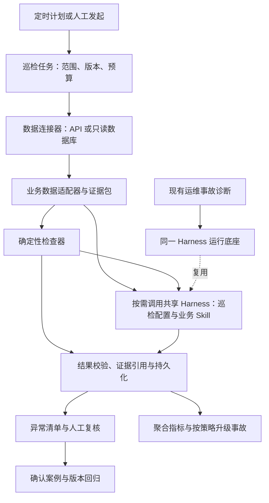

# 线上业务巡检调研与模块化设计

日期：2026-10-23。状态：按已确认的自动只读巡检范围实施；验证记录见[实施与验收](自动只读业务巡检实施与验收.md)。

目标是在 SentinelOps 中增加可复用的线上业务巡检能力，复用现有运维 Agent 的运行底座。计量检测、校准证书作为首个业务场景；后续业务通过数据适配、Skill 和检查器接入。

调研核对了当前源码、项目文档及下文链接的官方资料。后续实施采用隔离数据验证，不连接未经配置的生产目标。源码中存在的能力不等于生产部署已经升级或接入。

## 已确认的自动运行实施范围

用户于 2026-10-23 确认：模块化实现，复用运维 Agent 底座，设置机制自动巡检，业务侧只能读取。

1. Admin 配置服务、环境、数据源、检查规则、可选 Skill、运行间隔和预算，并显式启用。启用后后台按时运行，不需要逐次人工发起。暂停、改配置、删除或撤销配置人权限，停止后续读取与模型调用。
2. 采用持久化调度、单计划不重叠、增量分页、幂等和有限重叠回查；补查积压保存原时间窗口与游标。失败、预算耗尽和数据缺口分别记录，不伪装成正常。
3. 首版支持固定 GET API 证据协议，以及既有 PostgreSQL/MySQL 只读连接的普通表。数据库查询由明确字段生成并经现有白名单校验；业务目标没有 POST/PUT/DELETE、任意 SQL、Shell 或改判工具。
4. 共享 Harness 和模型网关；巡检使用独立上下文、工具集、结果结构和后台进程，不依赖 Incident，不阻塞现有事故诊断。Skill 是任务指引，检查器是注册的程序逻辑；首版实现必填、相等、数值范围等通用检查，具体计量阈值由业务配置。
5. 提供巡检计划、启停与手动补查、批次进度、逐项证据、Agent 意见和追加式人工复核页面。平台保存计划、进度、结果与审计属于正常运行；“只读”指不改变被检查的业务系统。
6. API 证据包含结构化事实和原文片段/页码等引用。首版不宣称已具备任意扫描 PDF 的 OCR、所有计量公式或未经样本验证的计量判定能力。没有充分证据时输出无法评估或待复核。
7. 只交付代码、迁移、部署说明和本地隔离验收；不自动启用任何生产计划，不部署远程目标，不修改生产判定。

## 1. 结论与设计取舍

现有架构适合增加业务巡检，无需重新建设一套 Agent 框架，但尚不能只添加一篇 Skill 就直接运行。

建议采用：**共享 Agent 运行底座 + 独立巡检任务 + 业务 Skill + 受控数据连接器 + 确定性检查器**。

- 共享模型适配、Harness、工具网关、调用预算、脱敏和证据记录机制。
- 巡检独立于事故运行，以服务、环境、数据范围和授权计划确定权限。
- Skill 描述业务检查方法、工具使用和例外处理；数值、单位、适用规则和权限由程序校验。
- 业务数据适配器负责把 API 或数据库记录转换为当前业务 Skill 所需的事实，不要求所有业务采用证书数据结构。
- 首版维持模块化单体和已有 PostgreSQL 后台任务方式，不增加多 Agent、通用工作流引擎或任意脚本执行。

用户当前的人工工作包含两项任务：一是主动发现线上核验问题；二是判断原 Agent 的业务结论是否正确。前者需要定时取数和异常筛选，后者需要独立依据、逐项复算与人工标签。单纯记录 Agent 调用成功率无法替代这两项工作。

## 2. 现有能力能复用到哪一步

| 当前实现 | 核对位置 | 复用方式与缺口 |
| --- | --- | --- |
| 受控 Harness，隔离子进程，禁用 Shell 等工具 | [harness.py](../../backend/app/integrations/harness.py)，`HarnessAdapter.run` | 可复用执行方式；已经支持传入 `system_prompt`。默认系统指令仍是事故诊断，并拼入 `Diagnosis` schema，业务巡检必须使用自己的任务指令和输出校验。 |
| MCP 工具网关，可传入工具定义 | [diagnostic_gateway.py](../../backend/app/integrations/diagnostic_gateway.py)，`DiagnosticGateway` | 工具白名单、传输、超时和用量记录可复用；配置校验、异常与默认用量归属仍关联诊断，需要小范围适配。 |
| Agent Skill 目录与按版本读取 | [knowledge.py](../../backend/app/models/knowledge.py)，`KnowledgeSkill`；[tools.py](../../backend/app/services/diagnosis/tools.py)，`list_skills/read_skill` 分支 | 复用 Skill 管理、版本和正文读取机制；当前目录可见性来自事故的服务范围，巡检必须按本轮任务范围筛选，并固定计划选择的主 Skill。 |
| 只读数据库连接、字段白名单、SQL 检查、超时与结果上限 | [服务级只读数据库接入](服务级只读数据库接入.md)、[database_sql.py](../../backend/app/integrations/database_sql.py) | 连接与校验能力可复用。现有工具按事故冻结权限，不能直接挂到无事故巡检；当前仅开放普通表，不支持视图、子查询、CTE。 |
| 诊断证据和权限范围 | [database_diagnosis.py](../../backend/app/services/database_diagnosis.py)、[tools.py](../../backend/app/services/diagnosis/tools.py) | 借鉴版本冻结、撤权检查和证据引用机制；`freeze_database_context`、`DiagnosticTools._call` 等明确依赖事故，不能删除这些校验来实现复用。 |
| 业务成功率和 LLM 性能指标 | [objectives.py](../../backend/app/services/operations/objectives.py)、[八项设计补全实施与验收](../project/八项设计补全实施与验收.md) | 可承接巡检后的聚合展示。现有业务成功率主要依据应用报告的 success/failure，不代表独立核实过判定正确性。 |
| 人工评价、固定案例与诊断回放 | [evaluation.py 模型](../../backend/app/models/evaluation.py)、[evaluation.py 服务](../../backend/app/services/operations/evaluation.py) | 可复用冻结案例、版本对比的设计；当前案例要求已有正式诊断，`EvaluationCase.analysis_id` 必填，不能直接容纳外部证书核验任务。 |
| 后台调度和 AI worker | [operations.py](../../backend/app/workers/operations.py)、[ai.py](../../backend/app/workers/ai.py) | 复用 PostgreSQL 任务、锁、心跳等现有方式。当前 AI worker 单并发，不能把整批证书巡检放进一次长调用阻塞诊断。 |

因此，复用的是运行机制和横向能力。业务入口、任务授权、输入对象和结果结构需要新增。不能通过伪造 Incident、放宽原工具权限或把巡检结果塞进事故根因字段来“直接复用”。

## 3. 业内做法及对本项目的启发

下表是官方产品或规范中可核对的能力；“本项目采用方式”是本次设计判断。

| 来源 | 已核对的做法 | 本项目采用方式 |
| --- | --- | --- |
| [LangSmith：线上评估](https://docs.langchain.com/langsmith/online-evaluations-llm-as-judge) | 对生产运行按条件筛选、抽样，支持后台历史补评和评估开销限制。 | 巡检按业务范围、风险和预算分层执行，历史回查与持续增量共用检查逻辑。 |
| [Langfuse：评估生产流量](https://langfuse.com/docs/evaluation/get-started/online) | 分开配置评估器和触发规则，结合程序检查、模型评价、人工复核及外部评分接入。 | 分开“怎样检查”和“检查哪些记录”；一次业务巡检可综合规则结果、模型意见和人工确认。 |
| [Langfuse：评估闭环](https://langfuse.com/docs/evaluation/core-concepts) | 生产中发现的失败案例回到固定数据集，用于后续版本实验。 | 人工确认的误判形成回归案例，分别验证线上业务 Agent 和巡检本身。 |
| [Phoenix：Tracing Helpers](https://arize.com/docs/phoenix/tracing/how-to-tracing/setup-tracing/instrument) | 用 OpenTelemetry/OpenInference 记录 Agent、工具等操作。 | 用业务 ID 关联业务事实和调用过程，便于定位识别、查规则或判定环节；不把 trace 当成业务正确性的真值。 |
| [Agent Skills 规范](https://agentskills.io/specification) | Skill 包含元数据、指引和可选参考资源，并按需加载；工具字段的支持依实现而异。 | 复用现有 Skill 目录，业务指引按需加载。平台在工具网关实施权限，Skill 声明不能自行获得连接或执行权。 |

需要特别注意：Langfuse 当前文档说明，单个 observation 的评估器不会自动获得同一 trace 的所有子节点和兄弟节点。证书任务的内页、规则、客户要求和原判定必须显式组装成证据包，不能假定接入 trace 后评估器自然拥有完整业务上下文。[官方说明](https://langfuse.com/docs/evaluation/evaluation-methods/llm-as-a-judge)

这些产品证明了“生产数据—评估—人工反馈—回归”的实现方式可行，不能证明它们自带计量证书判定能力。若线上已经使用其中一个平台，可以通过连接器读 trace、回写巡检分数；首版没有必要同时引入多个可观测平台。

## 4. 最小模块边界



| 模块 | 稳定职责 | 业务变化时修改哪里 |
| --- | --- | --- |
| 巡检任务 | 调度、游标、幂等、预算、取消、运行状态 | 改计划配置，不改调度框架。 |
| 数据连接器 | 鉴权、分页、受控读取、新鲜度、限流 | 新数据系统增加适配；API 与数据库属于传输方式。 |
| 业务数据适配器 | 组织业务对象、过程记录、原始附件和规则引用 | 证书、订单等分别适配，避免平台核心出现证书字段。 |
| Agent 任务配置 | 系统指令、工具集合、授权范围、输出 schema、预算 | 首版只支持 diagnosis 与 inspection 两种代码内注册的配置，不建设动态配置平台。 |
| 业务 Skill | 检查流程、证据要求、例外、差异解释 | 新业务主要增加或调整 Skill。 |
| 确定性检查器 | 明确规则的计算、比对、完整性检查 | 新计算语义增加少量经过测试的处理函数。 |
| 结果和复核 | 检查项、证据、疑似问题、人工结论、回归案例 | 共用外层结构，业务明细保留独立结构。 |

“复用同一个 Agent”在这里指同一运行引擎，不同任务使用独立会话、数据范围和工具集。运维诊断继续采用事故上下文；业务巡检采用计划冻结的服务、环境、数据源和业务记录范围。两者互不继承读取授权。

首版只抽出本轮确实需要共享的部分。已有 `system_prompt` 和工具定义参数足以作为起点；仍应补上任务相关配置校验、结果校验和用量归属。无需先大范围重构全部诊断模块。

## 5. Skill 怎样设计，什么不能只靠 Skill

一个业务巡检能力由三部分配合：

1. **Skill 指引**：告诉 Agent 怎样检查、先查什么、何时停止、如何引用证据。
2. **结构化规则配置**：保存适用范围、阈值、比较方式、规则来源和有效版本。
3. **注册检查器**：执行数值计算、单位换算和明确的状态核对；通过受控工具调用。

Skill 可以要求“检查客户指定点位是否覆盖”，但实际必查点位必须来自客户要求；Skill 可以要求“复算误差”，但不能临时创造误差公式和合格限。

计量业务的组织示例：

```text
业务 Skill：metrology_certificate_review
  指引：证据准备、仪器匹配、项目核对、差异分类、复核条件
  参考：审核后的规程条款与业务说明
  绑定规则：已确认版本的仪器/项目/客户判定配置
  可用检查器：点位覆盖、单位一致性、示值误差、限值比较等
```

上面是产品组织建议，不是现有 Skill 表已经支持的可执行包格式。现有 `KnowledgeSkill` 保存版本和指引正文，并不会自动注册检查器、解析资源目录或开放工具。首版保留现有 Skill 管理，用后端代码注册少量检查器，并由巡检计划引用其固定版本。

对接其他业务时：

- 已有数据和检查器足够：增加 Skill、规则和字段映射即可。
- 数据接口不同：补一个数据适配器。
- 需要新的业务计算：补对应检查器，再由 Skill 使用。

因此模块化能够降低接入成本，但不能承诺所有业务都只写提示词。Skill 文本、参考文档和业务数据均不能执行任意 Python、Shell 或 SQL，也不能扩大连接权限。这里的业务巡检 Skill 与现有需要审批的 Action Skill 分开，不能互换。

计划应固定主 Skill、规则版本和检查器版本。Agent 可在本轮授权目录内按需读取辅助指引，但不能自行选择更宽松的规则替换主规则。规则包可以由模型辅助整理，启用前由业务人员核对依据和边界案例。

## 6. 首个场景：计量检测、校准证书核验

### 6.1 判定依据先明确

用户已确认：有业务数据库，也可通过 API 取数。人工检查主要基于证书内页、检测项目、仪器、规程和客户要求；线上同时存在误判不合格和漏检不合格。

本次核对的 [CNAS-GL015:2022《判定规则和符合性声明指南》](https://www.cnas.org.cn/images/rkgf/sysrk/rkzn/2022/01/20/1642668363321027957.pdf)涵盖标准/规范、客户约定、判定规则及误接受和误拒绝风险的关系；[ILAC-G8:09/2019](https://ilac.org/?ddownload=122722)展示了简单接受与不同保护带等判定方法。[JCGM 106:2012](https://www.bipm.org/en/doi/10.59161/jcgm106-2012)说明测量不确定度在符合性判定中的作用。

设计上的直接要求：把本业务适用的依据和约定固化到可追溯配置中。上述指南用于设计参考，不能代替具体仪器、检测项目和业务场景适用的规程。

校准与符合性核验也要分开：校准建立量值关系，不自动意味着满足某项使用要求。[BIPM VIM：calibration](https://jcgm.bipm.org/vim/en/2.39.html)。平台应区分证书资料完整、校准结果可用，以及是否满足客户用途；不能因证书有签章或给出测量值就认定业务合格。

### 6.2 独立复核顺序

最小检查对象是“证书版本—仪器—项目—量程/档位—点位—核验尝试”。一张证书可能有多个项目，一项可能有多个点位，一次业务任务可能有多张证书和多次核验。

| 层次 | 具体检查 | 输出证据 |
| --- | --- | --- |
| 原文与结构 | 内页是否齐全；跨页表头、合并单元格、负号、小数点、单位和脚注是否识别正确 | 文件版本、哈希、页码和表格/单元格位置。 |
| 对象匹配 | 仪器型号、编号、准确度等级、量程；检测项目及通道、档位是否对应 | 原文片段与规范化对象。 |
| 依据适用性 | 规程/规范的编号、版本、适用范围；客户要求和约定判定规则是否覆盖本次用途 | 条款定位、客户要求版本、适用条件。 |
| 项目与点位覆盖 | 实际检测项目和点位是否满足适用规程及客户要求；是否遗漏关键项目 | 应查项与实有项的差集。 |
| 数值复算 | 按已确认规则计算示值误差等；核对单位、限值、边界、修约和必要的不确定度处理 | 原始值、公式、输入单位、转换、比较结果。 |
| 总结与对照 | 分项结果能否支持最终结论；原线上 Agent 的识别、选规则或计算在哪一步偏离 | 逐项差异、影响结论和复核理由。 |

注意客户使用范围：证书未覆盖所有量程，并不自动意味着不合格，应先确认本次要求检查的范围。客户要求与适用依据冲突时列出冲突，不默认“全部取最严”，也不允许客户配置静默覆盖必须适用的要求。

独立复核必须能接触原始证书内页。若只复用原 Agent 已识别的表格，两套流程可能一起接受同一个 OCR 错误。首版至少对临界值、识别疑点和人工随机样本回看原始页；没有原件时标记证据不足。

### 6.3 一个说明判定规则重要性的例子

以下为设计示例，非具体仪器规程。假设其他适用条件已经满足，某项目误差为 0.04 mm，容许范围为 ±0.05 mm，扩展不确定度为 0.02 mm：

- 若本次已约定并满足简单接受规则的适用条件，误差落在容许范围内。
- 若本次已约定的接受条件是 `|误差| + U ≤ 0.05 mm`，则不满足该接受条件。
- 未确定采用什么判定规则时，巡检应指出依据缺口，不能自行换规则后宣布原 Agent 错误。

不能把“不满足某种接受条件”解释成测得真值必然超限；输出应遵循该规则约定的二元或非二元结论。通用计算层只实现明确输入下的比较，规则选择由业务适用性和审核后的配置决定。

### 6.4 模型与程序分别做什么

Agent 负责理解内页结构、匹配候选项目与条款、提出有依据的映射、分析差异和组织复核材料。程序负责验证映射完整性、执行经过确认的公式和单位换算、检查阈值与覆盖、核验引用。

最终结果由服务端按检查项汇总，保留检查器原始结果；Agent 的解释不能覆盖程序已经发现的矛盾。总体结论还必须满足业务规定的分项汇总规则，缺项不能自动视为通过。

关键值无法可靠识别、规则不适用、多个依据冲突或缺少客户要求时，输出待复核/无法评估，并说明缺口。模型的自报置信度不能作为自动判定正确的依据。

同一模型可在独立巡检上下文中运行，但不将原 Agent 的结论当作事实来源。尽可能先形成独立检查结果，再对照原结论解释差异。更换评审模型也不能替代规则复算和人工校准。

## 7. 如何接入线上数据

### 7.1 推荐先接业务 API

用户已有 API 获取能力，优先验证能否用现有 API 取得下面的证据包。现有 API 足够时直接适配；不足时再补少量只读接口，避免先建设庞大数据中台。

接口形态示例，不是当前已实现路由：

- 增量列表：按更新时间/版本和游标列出核验任务，固定批次截止时间。
- 详情：按业务记录 ID 和版本返回原始资料引用、结构化数据、原判定及判定依据。
- 附件读取：通过受控只读接口获取该任务有权读取的证书内页；原件保留在现有存储中。

连接器负责鉴权、分页和限流；业务适配器负责把现有字段组织成证据。目标地址和资源路径来自登记配置，模型不能传入任意 URL。Token、数据库密码、长效签名地址不进入模型上下文。

### 7.2 数据库可作为补充或首个低改造入口

若 API 暂时拿不到完整数据，复用现有 PostgreSQL/MySQL 只读连接能力，优先访问只读副本或明确限流的业务表。固定查询模板增量获取记录；不让 Agent 每次巡检自由遍历数据库。

必须按巡检计划重新绑定服务、环境、表和字段权限。复用底层连接与 SQL 校验，不复用事故授权事实。

当前连接器不开放视图。若业务侧提供脱敏视图，需单独评估视图读取支持；首版可改用只读 API 或授权的普通数据表，不为了接入而绕过现有检查。

数据库若只保存总结果，无法支持内页复核；需要额外关联附件存储、原始响应及当时规则版本。接口与数据库是接入方式，证据是否完整才决定能否复查正确性。

### 7.3 最小证据契约

外层只统一业务身份、版本、来源和证据引用，业务事实保留各自 schema，不让订单、工单等业务迁就证书字段。

| 信息 | 通用字段意图 | 证书场景内容 |
| --- | --- | --- |
| 身份和版本 | 服务、环境、业务对象 ID、记录版本、尝试 ID | 核验任务、证书版本、核验重试。 |
| 时间 | 业务发生、处理完成、资料更新、平台读取时间 | 校准/检测日期、原判定时间、巡检取证时间，统一说明时区。 |
| 原始事实 | 业务事实及其原文位置 | 证书文件与哈希、内页、仪器、检测项目、量程、点位、测量值、单位、不确定度及适用的包含因子。 |
| 业务依据 | 规则/政策引用与版本 | 规程条款、客户要求、判定规则、适用范围和有效期。 |
| 被检查的输出 | 原结论、分项结果、依据 | 合格/不合格/待定、原 Agent 选中的限值与规则、计算过程。 |
| 执行过程 | trace/日志引用、模型和程序版本 | 原 Agent 的识别、检索、计算与汇总步骤；没有 trace 时也可先做结果复核。 |
| 人工反馈 | 标签、理由、证据与审核时间 | 真实误拒、漏检、规则争议或资料不足。 |

证书编号等低熵身份值不应只做普通哈希就当作匿名化。去标识应保留授权回查能力；模型只读取判定所需的最少内容。原件与敏感明细沿用原系统权限，平台保存必要快照或带完整性校验的受控引用，并覆盖复核所需保留期。

### 7.4 持续接入与补查

首版以定时增量拉取为主。有业务事件推送时，可后续增加签名验证、去重和定时对账；不要求第一版引入消息队列或 CDC。

- 按更新时间和稳定游标/主键分页，冻结本批次截止时间，并设置可配置的小段重叠回查，处理延迟提交和补录。源系统没有可靠版本或游标时，明确补查范围及覆盖限制。
- 幂等键绑定计划版本、业务对象版本、核验尝试和检查规则版本；同一记录修订后允许重新评估。
- 游标仅在该批原始事实或引用可靠落库后推进；后续模型失败可从本地任务重试，不漏过数据。
- 完成任务才评估最终判定；处理中任务按独立超时规则检查，避免把正常运行中状态判错。
- 分开记录数据接入成功、规则检查完成、模型评审完成和人工确认，源数据读取失败时显示巡检不完整。

复查历史结论使用当时证书版本、客户要求和适用规则；用今天的新要求做检查属于另一种任务，应明确标识。缺少历史快照不能伪造原判定当时的证据。

## 8. 通用巡检任务怎样运行

一份计划绑定服务与环境、数据源、业务适配器、主 Skill 版本、规则/检查器版本、扫描范围、频率和预算。授权由平台保存和校验，不依赖提示词声明。首版用现有配置机制和代码内注册，不建设通用插件市场。

建议分工：

- `operations-worker` 只完成短时的到期检查和任务入队，不在其治理循环里处理整份 PDF 或等待模型。
- 有界取数、解析和程序检查由持久化后台任务完成。首版可使用同一后端镜像的巡检 worker 进程隔离这部分工作，保持模块化单体，不增加独立业务服务。
- Agent 评审由同一后端镜像的独立巡检 worker 执行，一次处理一条并设时间与数量上限，共享既有 Harness 和模型网关，避免占用现有单并发事故诊断 worker。

每轮冻结授权和版本；工具调用前及结果保存前重新检查停用、撤权和配置变更。新一轮可重新取数，旧证据不冒充本轮新鲜观测。更改规则应产生新版本，不回写历史结论。

最少保留四类记录：巡检计划、巡检批次、逐对象/逐项结果、追加式人工复核。原件引用和计算证据可先保存在结果的结构化内容中，不必立即再拆一套复杂证据表。新增表均遵循项目 UTC 时间字段、软删除和审计规则。

巡检结果不自动等于事故。单条疑似误判先进入复核清单；达到明确质量阈值、重复模式或人工确认后，按配置关联/创建事故，继续使用现有诊断与整改流程。巡检只读业务数据，不自动改判、重开业务流程或触发修复动作。

## 9. 怎样降低人工量，又不放过错误

首版先全量执行已支持的低成本程序检查，再对疑点、临界值、未支持规则和随机样本使用模型。模型处理预算之外的记录明确标记未评审，不能统计为通过。

保留一部分随机人工核查“巡检未发现问题”的样本，才能发现巡检自己的漏检。只复核系统报出的疑点会高估巡检效果；不同抽样层的发现比例不能直接当作全量错误率。

结果分开保存：

| 层次 | 建议状态 | 用途 |
| --- | --- | --- |
| 执行状态 | 排队、运行、完成、部分完成、失败、取消 | 判断巡检是否实际完成。 |
| 自动检查结果 | 依据支持、发现矛盾、待复核、无法评估 | 记录证据能支持什么；“依据支持”仅覆盖本轮已检查范围。 |
| 人工复核 | 确认误拒、确认漏检、原判定正确、资料不足/争议 | 形成真实标签，独立于模型意见。 |

评价至少分别展示：

- 原 Agent 的误拒率：真实应合格的已标注样本中，被判不合格的比例。
- 原 Agent 的漏检率：真实应不合格的已标注样本中，被判合格的比例。
- 巡检发现率：已确认的原 Agent 错误中，巡检成功提出的比例；分别看误拒与漏检。
- 巡检问题确认率：送人工的疑似问题中，确认有错的比例，反映人工负担。
- 无法评估率、已检查范围、积压、新鲜度、单条成本和人工处理时间。

同时报告标签样本数、抽样方式和待定数量。未决项不能悄悄计为正确；未解决比例高时，单看准确率没有意义。

先用一批人工核对过的真实历史样本校准巡检，覆盖两类错误、临界值、单位转换、跨页表格、缺项和规则版本变化。小样本用于发现机制问题，不能据此宣称覆盖全部证书类型。模型评审也应对照人工标签校准。[Langfuse 校准说明](https://langfuse.com/guides/llm-as-a-judge-calibration-skill)

## 10. 建议实施顺序与验收

| 阶段 | 交付 | 验收重点 |
| --- | --- | --- |
| 一：证据对齐 | 选一种高频仪器/证书类型，整理 API 字段、原件位置、规程和客户要求，人工标记历史样本 | 能从总结果追溯到内页、项目、点位和当时依据；找出数据缺口。 |
| 二：最小通用巡检骨架 | 独立任务与授权范围，API/数据库接入中的一条有效路径，固定版本 Skill、少量检查器、证据与复核清单 | 无事故可运行；不越权；重复拉取不重复记问题；中断和缺数据不显示正常。 |
| 三：线上只读试运行 | 增量计划、预算、风险筛选、随机复核；并排展示原结论和独立检查 | 分别验证两类错误发现能力、复核负担、无法评估比例和真实成本；不改写生产结论。 |
| 四：验证模块边界 | 选一个实际需要的第二业务 Skill，复用相同任务、连接和结果框架 | 增加业务适配/规则/检查器即可接入，不改调度器、不复制一套 Harness。 |

第二业务场景是验证复用性的检查，不在首版提前实现一批无实际需求的模块。第一阶段不要求先建设完整 trace 平台、统一文档识别平台、通用规则语言或可视化工作流。

落地前需要业务方提供的材料是：一组已脱敏的正确与错误样本、对应原始内页、仪器/项目与规程的映射、客户要求及判定规则、现有 API/数据库字段说明。当前尚未取得这些材料，因此本报告给出可实施架构和接入契约，没有声称已验证真实业务效果。
